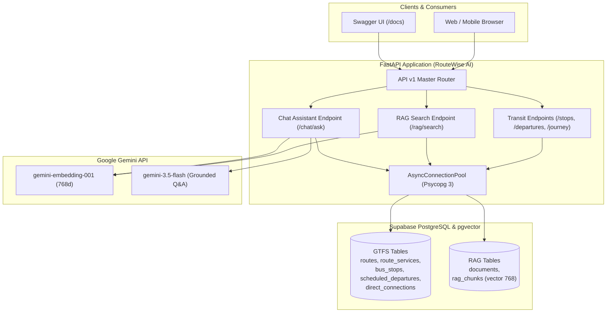

# RouteWise AI — Intelligent Public Transit Assistant for Sholinganallur

**RouteWise AI** is a production-grade, grounded transit information system and conversational assistant specialized in the **Sholinganallur transit corridor** (Old Mahabalipuram Road / IT Expressway, Chennai) and direct connections to **T. Nagar (CIT Nagar)**.

Built on **FastAPI**, **Supabase PostgreSQL with pgvector**, and **Google Gemini GenAI**, RouteWise AI combines deterministic relational queries over authoritative MTC GTFS timetable feeds with pgvector semantic search and grounded AI synthesis to eliminate hallucinations.

---

## Key Features

1. **Structured Transit Directory & Timetables**
   - **Bus Stop Search (`GET /api/v1/stops`):** Search 26 local transit stops with coordinate validation, support for quarantined unverified stops, and map-eligible filtering.
   - **Serving Routes (`GET /api/v1/stops/{stop_id}/routes`):** Discover all bus routes calling at a given stop with trajectory names and operating spans.
   - **Timetable Departures (`GET /api/v1/stops/{stop_id}/departures`):** Query static scheduled departures sorted by integer seconds past midnight, with full preservation of GTFS late-night service hours ($\ge 24:00:00$).
   - **Direct Corridor Journeys (`GET /api/v1/journey/direct`):** Deterministic lookup for direct services between Sholinganallur and T. Nagar (CIT Nagar) covering routes 19, 19A, M51, and 19BET with intermediate stop counts and travel durations.

2. **Semantic Knowledge Retrieval (RAG)**
   - **Vector Similarity Search (`POST /api/v1/rag/search`):** Vector search over 145 curated transit chunks across 86 documents using 768-dimensional `gemini-embedding-001` embeddings and pgvector cosine similarity.

3. **Grounded Conversational AI (`POST /api/v1/chat/ask`)**
   - Synthesizes answers using **Google Gemini** (`gemini-3.5-flash`), strictly grounded by relational GTFS database queries and retrieved RAG context.
   - Guardrailed against corridor hallucinations (e.g., forbidding direct-route claims for non-terminating lines such as 102CT/102PCT).
   - Clear disclaimers for static GTFS scope and lack of live GPS vehicle tracking.

4. **Production Architecture & Performance**
   - Asynchronous PostgreSQL connection pooling (`psycopg_pool.AsyncConnectionPool`) with autocommit to prevent pooler timeouts.
   - Decoupled migrations and ingestion pipelines.
   - Configurable CORS middleware, structured logging, and non-leaking exception handlers.

---

## Technology Stack

- **Runtime & Language:** Python 3.13+
- **API Framework:** FastAPI, Starlette, Uvicorn
- **Data Validation & Settings:** Pydantic v2, Pydantic-Settings
- **Database:** Supabase PostgreSQL with `pgvector` (`extensions` schema)
- **Database Driver & Pool:** Psycopg 3 (`psycopg`, `psycopg-pool`)
- **GenAI & Embeddings:** Google GenAI SDK (`google-genai`), `gemini-3.5-flash`, `gemini-embedding-001`
- **Testing:** Python `unittest`, `httpx` (FastAPI `TestClient`)

---

## System Architecture



---

## Dataset Description & Source

RouteWise AI is powered by static public transit feeds and domain knowledge curated for the southern Chennai IT corridor:

- **Source Dataset:** Metropolitan Transport Corporation (MTC) Chennai General Transit Feed Specification (GTFS) static timetable dataset.
- **Geographic Focus:** The Sholinganallur transit junction (Old Mahabalipuram Road / IT Expressway / Rajiv Gandhi Salai) and its direct arterial connection to T. Nagar (CIT Nagar bus terminus).
- **Relational GTFS Entities:** 58 distinct bus routes, 278 operational service variants, 26 localized bus stops, 18,439 scheduled departures, and 170 precomputed direct connection trips.
- **RAG Knowledge Base:** 86 structured transit domain documents segmented into 145 discrete chunks, including corridor guides, route profiles, stop profiles, and operational commuter advisories.
- **Vector Space:** 768-dimensional embeddings generated with `gemini-embedding-001` and indexed using PostgreSQL `pgvector` (`extensions` schema) with cosine similarity (`vector_cosine_ops`).

---

## Database Contents

| Entity / Table | Description | Verified Count |
| :--- | :--- | :---: |
| `public.routes` | Distinct MTC public route numbers | 58 |
| `public.route_services` | Operational trajectory variants | 278 |
| `public.bus_stops` | Stops within Sholinganallur transit area | 26 |
| `public.scheduled_departures` | Scheduled timetable departures across stops | 18,439 |
| `public.direct_connections` | Verified direct trips to CIT Nagar (T. Nagar) | 170 |
| `public.documents` | Domain documents (corridor guides, route profiles) | 86 |
| `public.rag_chunks` | Chunks with 768-dim embeddings in `extensions.vector` | 145 |

---

## Installation & Setup

### Prerequisites
- Python 3.13 or higher
- Supabase PostgreSQL instance with pgvector extension installed in `extensions` schema
- Google Gemini API Key

### 1. Clone & Set Up Virtual Environment
```bash
git clone <repository-url>
cd Sholinganallur_RouteWise

python -m venv .venv
# Windows:
.venv\Scripts\activate
# Linux/macOS:
source .venv/bin/activate

pip install -r requirements.txt
```

### 2. Environment Variables Configuration
Create a `.env` file in the root directory. **Never commit secrets to source control.**

```env
# Gemini API Configuration
GEMINI_API_KEY=<your-gemini-api-key>

# Supabase PostgreSQL Database Connection URL (PgBouncer/Pooler port 5432 or 6543)
DATABASE_URL=postgresql://<username>:<password>@<host>:5432/<dbname>

# Server & Application Settings
ENVIRONMENT=development
DEBUG=True
HOST=127.0.0.1
PORT=8000
LOG_LEVEL=INFO

# Database Connection Pool Settings
DB_POOL_MIN_SIZE=2
DB_POOL_MAX_SIZE=10
DB_POOL_TIMEOUT=30.0
DB_POOL_MAX_IDLE=300.0

# Gemini Model Settings
GEMINI_CHAT_MODEL=gemini-3.5-flash
GEMINI_CHAT_TEMPERATURE=0.2
GEMINI_CHAT_MAX_TOKENS=2048
EMBEDDING_MODEL=gemini-embedding-001
EMBEDDING_DIMENSIONS=768
```

### 3. Database Schema Setup & Ingestion (Initial Setup Only)
Database schema management and data ingestion are intentionally decoupled from server startup (no automated migrations run at boot):

1. **Apply Schema Migration:**
   Execute `database/migrations/001_initial_schema.sql` against your Supabase PostgreSQL database to create public tables, RLS policies, spatial indices, and register the `pgvector` extension in the `extensions` schema.

2. **Ingest GTFS Transit Data:**
   Populate routes, service variants, localized bus stops, scheduled departures, and direct connection trips:
   ```bash
   python scripts/ingest_gtfs.py
   ```

3. **Ingest RAG Knowledge Base & Embeddings:**
   Populate domain documents and pre-computed 768-dimensional vector chunks:
   ```bash
   python scripts/ingest_rag.py
   ```

*(Note: Data ingestion is idempotent and pre-completed for the production evaluation environment. Do not re-ingest data during standard demonstrations.)*

---

## Running the Application

### Recommended Application Launcher (Windows & Cross-Platform)
On Windows, Psycopg 3's asynchronous connection pool requires an asyncio `SelectorEventLoop`. To ensure the loop policy is configured before Uvicorn initializes its server event loop, start the application using the dedicated launcher:

```bash
python run.py
```

Optional arguments:
```bash
python run.py --host 127.0.0.1 --port 8000 --reload
```

### Alternative Direct Uvicorn Launch (Linux / macOS)
On non-Windows platforms, you can also launch directly via Uvicorn CLI:
```bash
uvicorn app.main:app --host 127.0.0.1 --port 8000 --reload
```

### Interactive API Documentation (Swagger & ReDoc)
- **Swagger UI:** [http://127.0.0.1:8000/docs](http://127.0.0.1:8000/docs)
- **ReDoc:** [http://127.0.0.1:8000/redoc](http://127.0.0.1:8000/redoc)
- **OpenAPI Schema:** [http://127.0.0.1:8000/openapi.json](http://127.0.0.1:8000/openapi.json)

---

## API Endpoints Overview

| Method | Path | Summary | Description |
| :--- | :--- | :--- | :--- |
| `GET` | `/` | Root Info | Landing endpoint with system status |
| `GET` | `/health` | Application Health | General health status for load balancers |
| `GET` | `/api/database/health` | Database Health | Supabase connection & pgvector extension check |
| `GET` | `/api/v1/` | API v1 Directory | Active modules and capabilities listing |
| `GET` | `/api/v1/stops` | Search Bus Stops | Query bus stops with coordinate filter |
| `GET` | `/api/v1/stops/{stop_id}/routes` | Serving Routes | List all bus lines calling at a specific stop |
| `GET` | `/api/v1/stops/{stop_id}/departures` | Scheduled Departures | Timetable departures with post-midnight GTFS time support |
| `GET` | `/api/v1/journey/direct` | Direct Connections | Sholinganallur to T. Nagar direct bus options |
| `POST` | `/api/v1/rag/search` | Semantic Retrieval | Cosine similarity vector search over `rag_chunks` |
| `POST` | `/api/v1/chat/ask` | Grounded Q&A | AI conversational assistant with zero hallucination guarantee |

---

## Live Demonstration Sequence

Follow this verified sequence during live academic evaluation or client demonstration:

1. **Start the Application:**
   ```bash
   python run.py
   ```
   Confirm console output shows `[DB Pool] PostgreSQL connection pool opened successfully`.

2. **Verify System & Database Health:**
   - Open [http://127.0.0.1:8000/health](http://127.0.0.1:8000/health) -> Verifies API server status is `"healthy"`.
   - Open [http://127.0.0.1:8000/api/database/health](http://127.0.0.1:8000/api/database/health) -> Verifies Supabase connection and `pgvector` version `0.8.2` in `extensions`.

3. **Discover Sholinganallur Bus Stops:**
   - Execute: `GET /api/v1/stops?query=sholinganallur&limit=5`
   - Observe: 26 total stops indexed in Sholinganallur; test `map_eligible_only=true` to demonstrate coordinate policy filtering.

4. **Inspect Routes Serving a Specific Stop:**
   - Execute: `GET /api/v1/stops/380/routes`
   - Observe: 26 active route variants calling at stop 380 (`SHOLINGANALLUR`), including routes 19, 102, 570, and 99.

5. **Query Scheduled Timetable Departures:**
   - Execute: `GET /api/v1/stops/380/departures?after_time=08:00:00&limit=5`
   - Observe: Chronologically ordered static scheduled bus departures starting at or after `08:00:00`.
   - Execute: `GET /api/v1/stops/380/departures?after_time=24:00:00&limit=5`
   - Observe: GTFS canonical late-night service hours ($\ge 24:00:00$) properly preserved (e.g., `24:02:00`).

6. **Demonstrate Direct Sholinganallur -> T. Nagar Journeys:**
   - Execute: `GET /api/v1/journey/direct?limit=10`
   - Observe: Deterministic direct connections returning exclusively verified lines (`19`, `19A`, `M51`, and `19BET`) with intermediate stop sequences and travel durations.

7. **Execute Grounded Conversational AI Assistant:**
   - Execute: `POST /api/v1/chat/ask` with JSON body:
     ```json
     {
       "question": "Which bus connects Sholinganallur to T. Nagar directly?",
       "top_k": 3
     }
     ```
   - Observe: Grounded answer synthesizing verified direct lines (`19, 19A, M51, 19BET`), referencing structured database context keys and citing specific RAG knowledge chunks.

8. **Review Disclosed Limitations & Guardrails:**
   - Inspect the `limitations` array in the chat response: verifies transparent disclosure of static GTFS timetable bounds and absence of real-time GPS tracking.

---

## Running Automated Tests

Run the complete test suite (220 automated unit, integration, and security tests):

```bash
python -m unittest discover -s tests -p "test_*.py"
```

Run targeted API test modules:
```bash
# Foundation and life-cycle tests:
python -m unittest tests/test_api_foundation.py

# Structured transit API tests:
python -m unittest tests/test_api_transit.py

# Semantic RAG retrieval tests:
python -m unittest tests/test_api_rag.py

# Grounded Gemini chat assistant tests:
python -m unittest tests/test_api_chat.py

# Direct journey regression tests:
python -m unittest tests/test_journey_direct.py
```

Run live integration smoke verification:
```bash
python scripts/verify_all_apis_step_5_5.py
```

---

## Scope & Operational Limitations

1. **Static Planned Schedules:** Timetable departures and journey travel times represent static General Transit Feed Specification (GTFS) planned schedules. RouteWise AI does **not** provide live GPS vehicle tracking or live arrival delays.
2. **Quarantined Bus Stop Coordinates:** Two bus stops (`SHOLINGANALLUR P.U.OFFICE`, ID `168` and `SHOLINGANALLUR`, ID `380`) have unverified placeholder coordinates in the source feed. Under the project's Quarantined Coordinates Policy, these coordinates are stored as `NULL` and excluded from map rendering (`map_eligible: false`), while remaining fully indexed for timetable and search queries.
3. **Corridor Journey Scope:** Direct connection lookups focus on the verified high-demand corridor between the Sholinganallur IT hub and T. Nagar (CIT Nagar terminal), serviced by Lines 19, 19A, M51, and 19BET.

