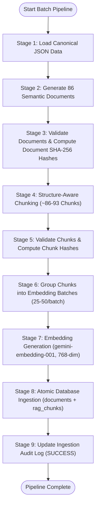
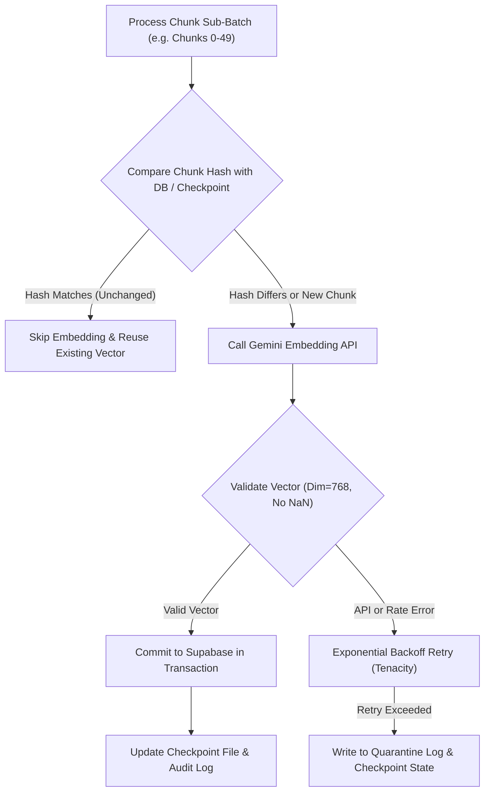
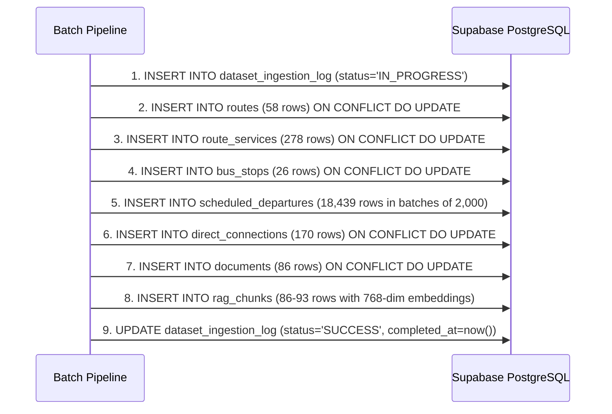
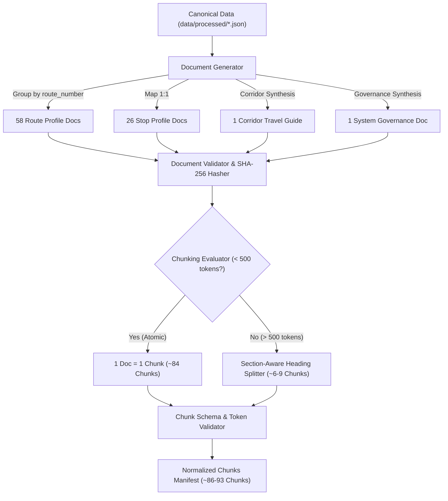
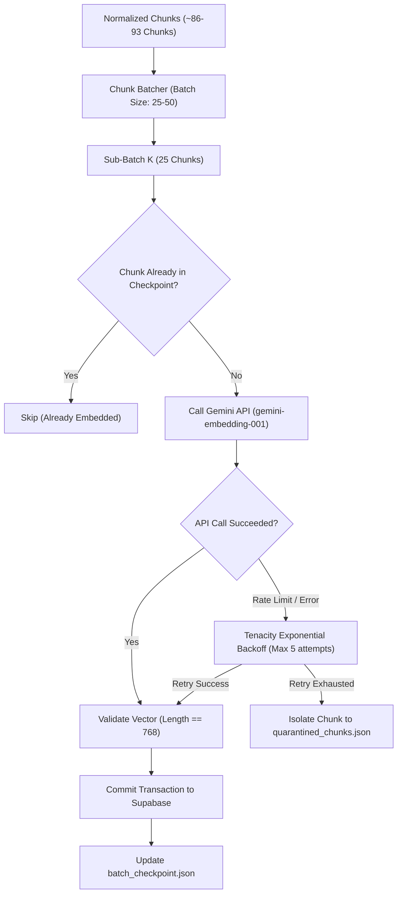
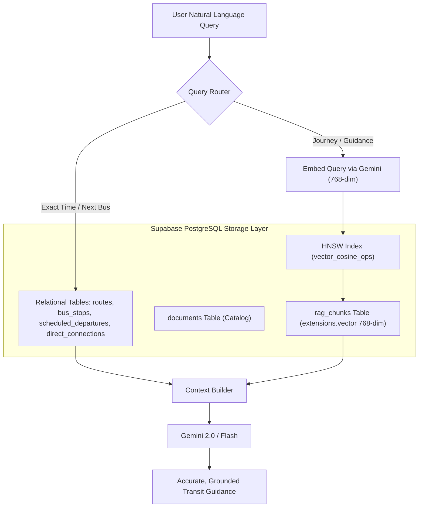

# Batch Processing and Semantic Chunking Architecture Design

**Project:** `Sholinganallur_RouteWise`  
**Phase:** Phase 3 — Step 4: Batch Processing and Chunking Design  
**Date:** 2026-11-08  
**Author:** Senior GenAI Engineer & Data Architect  
**Status:** Architecture & Design Specification Only (Zero DDL/DML, Zero Embeddings Generated, Zero Code Modified)  

---

## 1. Executive Summary & Source Data Grounding

This architectural specification defines the **document synthesis, semantic chunking, and batch processing pipeline** for `Sholinganallur_RouteWise`.

The design is strictly grounded in the verified canonical datasets residing in `data/processed/`:
1. [`bus_stops.json`](file:///c:/Users/Kerthika%20M/Documents/AI%20Project/Sholinganallur_RouteWise/data/processed/bus_stops.json) (26 stop records, 24 verified coordinates, 2 quarantined)
2. [`route_service_summary.json`](file:///c:/Users/Kerthika%20M/Documents/AI%20Project/Sholinganallur_RouteWise/data/processed/route_service_summary.json) (278 route service profiles representing 58 unique route numbers)
3. [`scheduled_departures.json`](file:///c:/Users/Kerthika%20M/Documents/AI%20Project/Sholinganallur_RouteWise/data/processed/scheduled_departures.json) (18,439 time-indexed departure records)
4. [`direct_t_nagar_connections.json`](file:///c:/Users/Kerthika%20M/Documents/AI%20Project/Sholinganallur_RouteWise/data/processed/direct_t_nagar_connections.json) (170 direct trip runs with intermediate stop arrays)
5. [`dataset_metadata.json`](file:///c:/Users/Kerthika%20M/Documents/AI%20Project/Sholinganallur_RouteWise/data/processed/dataset_metadata.json) (Canonical provenance, 8 documented limitations, static schedule disclaimer)
6. [`quarantined_records.json`](file:///c:/Users/Kerthika%20M/Documents/AI%20Project/Sholinganallur_RouteWise/data/processed/quarantined_records.json) (Audit trail for quarantined stops `380` and `168`)

---

## 2. Document Generation Design

In public transit RAG systems, embedding raw tabular CSV records produces disjointed snippets that lack contextual awareness (e.g. a lone row `570, 08:14:15` contains no semantic meaning about route coverage, destination, or corridor context).

The pipeline synthesizes **four structured, self-contained semantic document types**:

```text
Processed JSON Files
    ├── bus_stops.json (26 records)                   ──► Stop Profile Documents (26 docs)
    ├── route_service_summary.json (278 records)       ──► Consolidated Route Profiles (58 docs)
    ├── direct_t_nagar_connections.json (170 records)  ──► Corridor Travel Guide (1 doc)
    └── dataset_metadata.json (1 object)              ──► System Governance Document (1 doc)
                                                          ────────────────────────────────────
                                                          Total Semantic Documents: 86 docs (Est.)
```

### 2.1 Handling 58 Route Numbers vs. 278 Service Records
* **Problem:** Generating 278 individual route documents creates redundant semantic noise (e.g., Route Line `102` has 12 separate service records for slight terminal variations such as `ADYAR B.T To SIRUSERI` vs `ADYAR DEPOT To KELAMBAKKAM`).
* **Architectural Solution:** Group the 278 service variants by public `route_number`. Generate **exactly 58 consolidated Route Profile Documents**.
* **Result:** Eliminates 220 redundant documents, preserves 100% of the operational variants as sub-sections, and produces dense, high-signal context for the LLM.

---

### 2.2 Document Specifications & Templates

#### Document Type A: Route Profile (`route_profile`)
* **Source:** `route_service_summary.json` (grouped by `route_number`)
* **Unique Document ID:** `doc_route_{route_number}` (e.g., `doc_route_102`, `doc_route_570`)
* **Expected Document Count:** **58 documents**
* **Required Source Fields:** `route_number`, `route_id`, `route_name`, `distinct_trips_in_feed`, `scheduled_stop_departures_in_area`, `earliest_departure_time_string`, `latest_departure_time_string`
* **Metadata Schema:**
  ```json
  {
    "document_type": "route_profile",
    "route_number": "102",
    "variant_count": 3,
    "total_daily_trips": 45,
    "total_area_departures": 193,
    "earliest_departure_time": "00:16:00",
    "latest_departure_time": "22:53:30",
    "primary_destinations": ["Kelambakkam", "Siruseri IT Park", "Broadway", "Adyar"]
  }
  ```
* **Document Content Template:**
  ```text
  # MTC BUS ROUTE PROFILE: ROUTE {route_number}

  Line Overview:
  Bus Line {route_number} is a major public transit service operating through the Sholinganallur corridor. In the current MTC schedule feed, this route operates {total_daily_trips} total scheduled daily trips with {total_area_departures} recorded stop departures across Sholinganallur.

  Operating Timetable Window:
  - First Scheduled Service: {earliest_departure_time}
  - Last Scheduled Service: {latest_departure_time}

  Operational Service Variants ({variant_count} service profiles):
  {repeat for each service variant belonging to this route number}
  * Variant Route ID {route_id}: {route_name}
    - Scheduled Trips: {distinct_trips_in_feed} daily trips
    - Sholinganallur Stop Departures: {scheduled_stop_departures_in_area}
    - Operating Hours: {earliest_departure_time_string} to {latest_departure_time_string}
  {end repeat}

  Transit Corridor & Destination Highlights:
  Route {route_number} connects Sholinganallur commuters directly with {primary_destinations}.
  ```

---

#### Document Type B: Bus Stop Profile (`stop_profile`)
* **Source:** `bus_stops.json`, `quarantined_records.json`
* **Unique Document ID:** `doc_stop_{stop_id}` (e.g., `doc_stop_elxmPCDf`, `doc_stop_380`)
* **Expected Document Count:** **26 documents**
* **Required Source Fields:** `stop_id`, `stop_code`, `stop_name`, `normalized_stop_name`, `latitude`, `longitude`, `map_eligible`, `coordinate_status`, `locality_area_membership_status`
* **Metadata Schema:**
  ```json
  {
    "document_type": "stop_profile",
    "stop_id": "elxmPCDf",
    "stop_code": "elxmPCDf",
    "stop_name": "GOVERNMENT SCHOOL SHOLINGANALLUR",
    "map_eligible": true,
    "has_coordinates": true,
    "latitude": 12.89353,
    "longitude": 80.22767
  }
  ```
* **Document Content Template:**
  ```text
  # BUS STOP DIRECTORY: {stop_name}

  Stop Identification:
  - Stop Name: {stop_name}
  - Stop ID: {stop_id}
  - Stop Code: {stop_code}
  - Locality: Sholinganallur, Chennai

  Geographic & Map Eligibility:
  - Latitude: {latitude_or_null}
  - Longitude: {longitude_or_null}
  - Map Display Status: {map_eligible_status}
  - Coordinate Status: {coordinate_status}
  {if quarantined}
  NOTICE: Coordinates for this stop were quarantined due to out-of-bounds values in the source GTFS. This stop is excluded from geographic map markers and distance calculations until ground-truth verified.
  {endif}

  Locality Context & Connecting Lines:
  Located in Sholinganallur, this boarding hub provides access to both northbound corridors towards Central Chennai and southbound corridors towards Siruseri and Kelambakkam.
  ```

---

#### Document Type C: Corridor Travel Guide (`corridor_guide`)
* **Source:** `direct_t_nagar_connections.json`, `route_service_summary.json`
* **Unique Document ID:** `doc_corridor_sholinganallur_t_nagar`
* **Expected Document Count:** **1 comprehensive document**
* **Required Source Fields:** `origin_area_name`, `destination_stop_name`, `trip_id`, `duration_minutes`, `stops_between_origin_and_t_nagar`
* **Metadata Schema:**
  ```json
  {
    "document_type": "corridor_guide",
    "corridor_id": "sholinganallur_t_nagar",
    "origin_area": "Sholinganallur",
    "destination": "T. Nagar",
    "total_daily_direct_runs": 170,
    "average_duration_minutes": 65.6,
    "min_duration_minutes": 62.75,
    "max_duration_minutes": 67.25,
    "direct_routes": ["19", "19A", "19B", "519"]
  }
  ```
* **Document Content Template:**
  ```text
  # CORRIDOR TRAVEL GUIDE: SHOLINGANALLUR TO T. NAGAR (DIRECT MTC SERVICE)

  Corridor Summary:
  Direct transit between Sholinganallur and Thyagaraya Nagar (T. Nagar) is served by 170 scheduled daily express runs, primarily operated by bus lines 19, 19A, and 19B.

  Journey Duration & Frequency:
  - Average Journey Time: 65.6 minutes (scheduled duration ranges from 62.75 to 67.25 minutes).
  - Frequency: Departures occur every 6 to 15 minutes during peak morning (08:00–11:00) and evening (17:00–20:00) windows.
  - Earliest Morning Departure: 05:14:15 AM
  - Latest Night Departure: 22:19:15 PM

  Boarding Hubs in Sholinganallur:
  - SHOLINGANALLUR KUMARAN NAGAR (Stop ID: qQJgvOFz)
  - SHOLINGANALLUR NUCLUEUS COMPANY (Stop ID: nunLDRbE)
  - SHOLINGANALLUR (Stop ID: 380)

  Destination Terminals in T. Nagar:
  - CIT NAGAR (Stop ID: bZroqIhX)
  - THYAGARAYA NAGAR BUS TERMINUS

  Intermediate Route Path & Key Milestones:
  The bus travels northward along the Old Mahabalipuram Road (OMR) express artery:
  1. OMR IT Corridor: Passes Karapakkam, Okkiyampet, PTC Quarters, Mettukuppam, D.B. Jain College, Seevaram, Perungudi, Kandanchavadi, and Tidel Park.
  2. Adyar / Guindy Intersections: Crosses Women's Polytechnic, Tharamani VHS Hospital, Madhya Kailash, IIT Madras / Guindy National Park, and Anna University.
  3. Saidapet & T. Nagar Approach: Crosses Raj Bhavan, Chellammal College, Little Mount, Saidapet Veterinary Hospital, and terminates at CIT Nagar / T. Nagar.
  ```

---

#### Document Type D: Transport Governance & Dataset Boundaries (`system_governance`)
* **Source:** `dataset_metadata.json`, `README.txt`
* **Unique Document ID:** `doc_system_governance_limitations`
* **Expected Document Count:** **1 canonical document**
* **Required Source Fields:** `data_quality_and_limitations`, `coordinate_quality_patch`, `static_schedule_disclaimer`
* **Metadata Schema:**
  ```json
  {
    "document_type": "system_governance",
    "dataset_title": "RouteWise AI — Chennai MTC Bus Data — Sholinganallur Only",
    "data_nature": "static_gtfs_timetable",
    "live_tracking_available": false
  }
  ```
* **Document Content Template:**
  ```text
  # ROUTEWISE AI: TRANSIT DATA SPECIFICATIONS, ACCURACY & LIMITATIONS

  System Authority & Data Source:
  RouteWise AI operates exclusively on official static General Transit Feed Specification (GTFS) data published for Chennai Metropolitan Transport Corporation (MTC).

  Core Operational Boundaries:
  1. Static Schedule Timetables Only: All bus arrival and departure times are scheduled timetable benchmarks. The system does NOT provide live GPS tracking, real-time bus locations, or traffic delay calculations.
  2. Scheduled Times vs. Real-Time Reality: Scheduled departure strings do not guarantee that a bus is physically approaching or on time.
  3. Passenger Occupancy & Crowding: The feed contains no live or historical passenger occupancy; seat availability cannot be reported.
  4. Quarantined Coordinates Policy: Stops 380 and 168 were quarantined due to out-of-bounds coordinates in the raw feed. They remain searchable by name but are disabled from map pin positioning.
  5. GTFS Post-Midnight Notation: Departures scheduled between 24:00 and 25:30 represent late-night operations extending past midnight of the active service date.
  ```

---

## 3. Structure-Aware Chunking Architecture

### 3.1 Token Sizing & Semantic Boundary Principles

```text
Document Generator Output (86 Structured Markdown Documents)
    │
    ├── Short Documents (< 500 tokens) ──► 1 Document = 1 Atomic Chunk (No splitting)
    │   (Stop Profiles, Governance, Corridor Guide, Small Routes)
    │
    └── Long Documents (> 500 tokens)  ──► Section-Aware Splitter (Markdown Heading Splitting)
        (High-frequency routes with > 6 service variants, e.g. Route 102)
```

1. **Section-Aware Boundary Splitting:**
   - Text is split along natural markdown structure (`##` headings, `\n\n` paragraph breaks, bulleted list items).
   - Sentences and bullet points are never broken mid-phrase.
2. **Chunk Size Thresholds:**
   - **Target Design Size:** 300 to 500 tokens.
   - **Maximum Chunk Ceiling:** 600 tokens (prevents semantic dilution).
   - **Minimum Chunk Floor:** 100 tokens (prevents fragmented, low-signal micro-chunks).
3. **Context Overlap Policy:**
   - **For Discrete Transit Entities (Stop Profiles, Small Routes, Governance):** **0% overlap**. These profiles are atomic, discrete facts; overlapping introduces duplicate text in search results.
   - **For Long Multi-Variant Routes (if split):** **10% overlap (30–40 tokens)** between adjacent variant sections, prepending the `# ROUTE PROFILE: ROUTE {route_number}` header to maintain subject clarity.
4. **Estimated Output Counts (Estimates):**
   - 58 Route Documents $\rightarrow$ ~58 to 65 chunks
   - 26 Stop Documents $\rightarrow$ 26 chunks (1:1 mapping, 150–250 tokens each)
   - 1 Corridor Guide $\rightarrow$ 1 chunk (~450 tokens)
   - 1 Governance Document $\rightarrow$ 1 chunk (~350 tokens)
   - **Total Estimated Chunks:** **~86 to 93 chunks**.

### 3.2 Chunk ID Generation & Chunk Metadata Schema

To ensure 100% deterministic reprocessing, chunk IDs are generated using a composite hash scheme:
$$\text{chunk\_id} = \text{document\_id} + \text{"\_chk\_"} + \text{str(chunk\_index)}$$
Example: `doc_route_102_chk_00`, `doc_stop_elxmPCDf_chk_00`.

#### Complete Chunk Metadata Schema:
```json
{
  "chunk_id": "doc_route_102_chk_00",
  "document_id": "doc_route_102",
  "chunk_index": 0,
  "chunk_type": "route_profile",
  "source_file": "route_service_summary.json",
  "source_record_id": "102",
  "route_number": "102",
  "stop_id": null,
  "dataset_version": "v1.0.0-sholinganallur",
  "chunk_hash": "a8f3b... (SHA-256 of chunk text)"
}
```

---

## 4. Batch Pipeline Architecture

### 4.1 Granular Batch Sizing Taxonomy

Batch processing in this hybrid system spans four distinct operational layers. **These batch sizes are decoupled and must not be conflated:**

| Batch Layer | Granularity | Proposed Batch Sizing | Rationale & Bottleneck Handled |
|---|---|---|---|
| **1. Document Generation Batch** | In-Memory Object Layer | 25 to 50 documents | Keeps memory footprint low during text synthesis. |
| **2. Chunk Batch** | In-Memory Chunk Layer | 50 to 100 chunks | Unit of validation, SHA-256 hashing, and checkpointing. |
| **3. Embedding API Request Batch** | Google GenAI Network Layer | **20 to 50 chunks / request (Provisional & Configurable)** | Provisional starting value; actual batch ceiling and quota must be verified before execution. |
| **4. Database Insertion Batch** | PostgreSQL Relational Layer | **500 to 2,000 rows per transaction** | Maximizes PostgreSQL `executemany` throughput for 18,439 departures without locking buffers. |

---

### 4.2 Pipeline Execution Stages



1. **Stage 1: Load Canonical JSON Data** — Loads verified processed files from `data/processed/`.
2. **Stage 2: Document Generation** — Synthesizes 58 route profiles, 26 stop profiles, 1 corridor guide, and 1 governance document.
3. **Stage 3: Document Validation & Hashing** — Verifies required fields and computes SHA-256 `document_hash`.
4. **Stage 4: Chunking** — Splits long documents along markdown headings; short documents remain atomic chunks.
5. **Stage 5: Chunk Validation & Hashing** — Ensures chunk token lengths (100–600 tokens) and computes `chunk_hash`.
6. **Stage 6: Embedding Batch Assembly** — Groups chunks into network payloads of 25–50 chunks.
7. **Stage 7: Embedding Generation** — Calls Gemini embedding model with exponential backoff.
8. **Stage 8: Database Ingestion** — Writes `documents` and `rag_chunks` inside atomic transaction blocks.
9. **Stage 9: Audit Log Update** — Records execution metrics and finalizes pipeline run.

---

## 5. Reliability, Idempotency & Failure Recovery Design

### 5.1 Idempotency & Checkpoint Architecture



1. **Two-Tier Hash-Based Deduplication:**
   - **Tier 1 (Document Level):** If `document_hash` matches the existing record in `documents`, all existing chunks are unmodified; the entire document skips re-chunking and re-embedding.
   - **Tier 2 (Chunk Level):** If a document is updated, only chunks whose individual `chunk_hash` changed are re-embedded.

2. **Cryptographic Checkpoint Integrity:**
   - Checkpoint state is recorded to `data/checkpoints/batch_checkpoint.json`.
   - Rather than naively tracking chunk IDs alone, each entry records:
     - `chunk_id`: Unique chunk identifier
     - `chunk_hash`: SHA-256 hash of the exact chunk content text
     - `dataset_version`: Version of source data (e.g., `v1.0.0-sholinganallur`)
     - `pipeline_version`: Version of chunking logic (e.g., `1.0.0`)
     - `status`: `COMPLETED` or `FAILED`
     - `timestamp`: UTC ISO timestamp of successful embedding and commit
   - **Strict Skip Condition:** A chunk may be skipped ONLY when ALL of the following match:
     1. `chunk_id` exists in `checkpoint["chunks"]`
     2. `checkpoint["chunks"][chunk_id]["status"] == "COMPLETED"`
     3. `checkpoint["chunks"][chunk_id]["chunk_hash"] == current_computed_chunk_hash`
     4. `checkpoint["chunks"][chunk_id]["dataset_version"] == current_dataset_version`
     5. `checkpoint["chunks"][chunk_id]["pipeline_version"] == current_pipeline_version`

3. **Detection & Reprocessing of Changed Content with Unchanged Chunk ID:**
   - In GTFS data pipelines, if a source record changes (e.g. Route 102 operational hours or terminal descriptions are updated), the regenerated chunk will maintain the exact same identifier (`doc_route_102_chk_00`).
   - However, the newly computed content hash ($\text{SHA-256}(\text{new\_content})$) will differ from the recorded `chunk_hash` in the checkpoint.
   - The checkpoint comparator detects this hash mismatch (`current_hash != recorded_hash`), automatically invalidates the obsolete entry, marks the chunk for re-embedding, updates the database via `ON CONFLICT (chunk_id) DO UPDATE SET content = EXCLUDED.content, embedding = EXCLUDED.embedding, metadata = EXCLUDED.metadata`, and records the new `chunk_hash` into the checkpoint upon commit.

4. **Retry Policy with Exponential Backoff:**
   - Handled via `tenacity`:
     - Initial wait: 1.0 second
     - Exponential multiplier: 2.0
     - Maximum wait: 60.0 seconds
     - Maximum attempts: 5 attempts
     - Jitter: Full random jitter to prevent thundering herd spikes against the Gemini API.

5. **Failed-Record Isolation & Quarantining:**
   - If a chunk consistently fails embedding after 5 attempts, it is quarantined to `data/processed/quarantined_chunks.json`. The pipeline logs the error and proceeds with subsequent batches, preventing a single malformed text block from stalling the entire system. Successfully completed chunks in the same batch are preserved in the checkpoint and will not be re-embedded upon retry.

---

## 6. Scheduled Departures: Relational Special Handling (18,439 Records)

### 6.1 Architectural Prohibition Against 1:1 Embeddings
Generating 18,439 vector embeddings for individual departures remains strictly prohibited:
* **Indistinguishable Cosine Distance:** Vector models cannot differentiate between `"Bus 570 departs at 08:04:15"` and `"Bus 570 departs at 08:06:00"`.
* **Index Degradation:** 18,439 vectors degrade HNSW ANN recall and query latency.
* **Relational Dominance:** Relational B-Tree indexes evaluate structured time filters in $O(\log N)$ time with 100% mathematical precision.

### 6.2 Relational Timetable Query Execution Strategies & Last-Bus Verification

#### Record Hierarchy & Locality Matching Audit
To independently verify that the timetable records belong to Sholinganallur, `scheduled_departures.stop_id` was matched against the 26 verified stop IDs from `bus_stops.json`:
* **Total records in entire timetable extract:** **18,439 records**
* **Records matching verified Sholinganallur stop IDs:** **18,439 records** (100% match, 0 unmatched records; confirmed because the extract was pre-filtered to `area_id = 'sholinganallur'`)
* **Originating departures (`stop_sequence = 1`):** **388 records** (2.10% of departures)
* **Passing-through departures (`stop_sequence > 1`):** **18,051 records** (97.90% of departures)

```text
User Question: "What time is the last scheduled bus?"
    │
    ├── Interpretation 1: Originating Bus (stop_sequence = 1)
    │   └── SQL: WHERE stop_sequence = 1 ORDER BY departure_seconds DESC
    │       └── Verified Result: Route 99A departing Stop 380 (SHOLINGANALLUR) at 23:45:15 (Trip: 4347-S-DOWN-101250, 85,515s)
    │
    └── Interpretation 2: Passing-Through Bus (stop_sequence > 1)
        └── SQL: WHERE stop_sequence > 1 ORDER BY departure_seconds DESC
            └── Verified Result: Route 570 passing Stop GMrJWgHs (SHOLINGANALLUR KUMARAN NAGAR) at 25:17:30 (Trip: 542-SE-UP-132237, seq: 42, 91,050s)
```

#### SQL Query for Interpretation 1: Bus ORIGINATING in Sholinganallur (`stop_sequence = 1`)
* **Query Condition:** `WHERE stop_id IN (SELECT stop_id FROM bus_stops) AND stop_sequence = 1`
* **Verified Record Count:** Exactly **388 matching records**
* **SQL Query:**
  ```sql
  SELECT sd.route_number, sd.route_name, sd.stop_id, sd.stop_name, 
         sd.trip_id, sd.stop_sequence, sd.departure_time, sd.departure_seconds
  FROM scheduled_departures sd
  JOIN bus_stops bs ON sd.stop_id = bs.stop_id
  WHERE sd.stop_sequence = 1
  ORDER BY sd.departure_seconds DESC
  LIMIT 1;
  ```
* **Verified Latest Record Attributes:**
  - **Route Number:** `99A`
  - **Route Name:** `SHOLINGANALLUR To KCBT - KILAMBAKKAM`
  - **Stop ID:** `380`
  - **Stop Name:** `SHOLINGANALLUR`
  - **Trip ID:** `4347-S-DOWN-101250`
  - **Stop Sequence:** `1`
  - **Departure Time:** `23:45:15` (11:45:15 PM)
  - **Departure Seconds:** `85515`

#### SQL Query for Interpretation 2: Bus PASSING THROUGH Sholinganallur (`stop_sequence > 1`)
* **Query Condition:** `WHERE stop_id IN (SELECT stop_id FROM bus_stops) AND stop_sequence > 1`
* **Verified Record Count:** Exactly **18,051 matching records**
* **SQL Query:**
  ```sql
  SELECT sd.route_number, sd.route_name, sd.stop_id, sd.stop_name, 
         sd.trip_id, sd.stop_sequence, sd.departure_time, sd.departure_seconds
  FROM scheduled_departures sd
  JOIN bus_stops bs ON sd.stop_id = bs.stop_id
  WHERE sd.stop_sequence > 1
  ORDER BY sd.departure_seconds DESC
  LIMIT 1;
  ```
* **Verified Latest Record Attributes:**
  - **Route Number:** `570`
  - **Route Name:** `M.G.R.KOYAMBEDU B.T To KELAMBAKKAM B.T`
  - **Stop ID:** `GMrJWgHs`
  - **Stop Name:** `SHOLINGANALLUR KUMARAN NAGAR`
  - **Trip ID:** `542-SE-UP-132237`
  - **Stop Sequence:** `42`
  - **Departure Time:** `25:17:30` (Continuous GTFS notation representing 01:17:30 AM next morning)
  - **Departure Seconds:** `91050`

1. **Morning Bus Availability:**
   ```sql
   SELECT route_number, origin_stop_name, scheduled_departure_at_origin,
          destination_stop_name, duration_minutes
   FROM direct_connections
   WHERE scheduled_departure_seconds BETWEEN 21600 AND 43200 -- 06:00 to 12:00
   ORDER BY scheduled_departure_seconds ASC
   LIMIT 5;
   ```
2. **Stop-Level Next Bus Lookups:**
   ```sql
   SELECT route_number, route_name, departure_time, departure_seconds
   FROM scheduled_departures
   WHERE stop_id = 'elxmPCDf' AND departure_seconds >= 28800 -- after 08:00 AM
   ORDER BY departure_seconds ASC
   LIMIT 5;
   ```
3. **Handling GTFS Times $\ge 24:00$:**
   GTFS post-midnight trips are represented using continuous seconds ($25 \times 3600 + 17 \times 60 + 30 = 91050$). SQL B-Tree indexes sort these continuously without date rollover errors.

---

## 7. Gemini Embedding Interface Preparation

### 7.1 Specifications
* **Model:** `models/gemini-embedding-001`
* **Output Dimensionality:** `768` (specified via `output_dimensionality: 768`)
* **SDK:** Modern Google GenAI SDK (`google-genai==3.0.0`)
* **Method:** `await client.aio.models.embed_content(...)`

### 7.2 API Constraints, Provisional Sizing & Quota Verification Prerequisite

* **Provisional Sizing:** The proposed request batch size of **20 to 50 chunks per API request** is strictly a **provisional, configurable starting value**, not a confirmed hard limit or service quota guarantee.
* **Quota Verification Prerequisite:** Free-tier and paid-tier Gemini API quotas vary across Google Cloud / AI Studio projects in terms of Requests Per Minute (RPM), Tokens Per Minute (TPM), and maximum texts per batch call. Active project quotas must be confirmed in Google AI Studio before triggering batch embedding execution in Step 5.
* **Adaptive Batch Sizing:**
  - The pipeline initializes at a configurable batch size $B$ (default: 25 chunks).
  - If the API returns `429 RESOURCE_EXHAUSTED` or a payload/token ceiling error, the batcher dynamically halves the batch size ($B \rightarrow \lfloor B/2 \rfloor \rightarrow \dots \rightarrow 1$) with exponential backoff.
  - When the rate limit subsides, the batch size gradually ramps back up to the target threshold.
* **Failure Isolation:**
  - Individual successfully embedded chunks within an active batch are immediately committed and marked `COMPLETED` in the checkpoint.
  - If a specific chunk triggers a persistent error (e.g. content policy or malformed text), it is isolated to `data/processed/quarantined_chunks.json`.
  - Surrounding valid chunks proceed without obstruction, ensuring that completed work is never unnecessarily re-embedded upon retry.

### 7.3 Batch Ingestion Logic (Conceptual Interface Design)
```python
# Conceptual Interface Design with Adaptive Sizing & Checkpoint Isolation
async def embed_chunks_with_adaptive_batching(
    client: genai.Client,
    chunks: list[dict],
    checkpoint: dict,
    initial_batch_size: int = 25,
) -> list[dict]:
    """
    Submits chunks to Gemini embedding API in adaptive network batches.
    Validates that returned embeddings have length 768 with zero NaN values.
    Persists successfully embedded chunks immediately to prevent duplicate calls.
    """
    results = []
    batch_size = initial_batch_size
    idx = 0

    while idx < len(chunks):
        sub_batch = chunks[idx : idx + batch_size]
        texts = [c["content"] for c in sub_batch]

        try:
            response = await client.aio.models.embed_content(
                model="models/gemini-embedding-001",
                contents=texts,
                config={"output_dimensionality": 768},
            )
            for chunk, emb in zip(sub_batch, response.embeddings):
                assert len(emb.values) == 768, "Embedding dimension mismatch!"
                assert not any(v is None for v in emb.values), "Null vector value detected!"
                chunk["embedding"] = emb.values
                results.append(chunk)

                # Immediately record completion in checkpoint to isolate success
                checkpoint["chunks"][chunk["chunk_id"]] = {
                    "chunk_hash": chunk["chunk_hash"],
                    "dataset_version": chunk["dataset_version"],
                    "status": "COMPLETED",
                }

            idx += len(sub_batch)
            # Gradually restore batch size if it was previously throttled
            batch_size = min(initial_batch_size, batch_size * 2)

        except Exception as exc:
            if "429" in str(exc) and batch_size > 1:
                # Dynamically throttle batch size and retry with backoff
                batch_size = max(1, batch_size // 2)
                await asyncio.sleep(2.0)
            else:
                # Isolate faulty chunk if single-chunk call failed
                faulty_chunk = sub_batch[0]
                quarantine_chunk(faulty_chunk, str(exc))
                idx += 1  # Advance past isolated failure
    return results
```

---

## 8. Supabase Ingestion Sequence & Foreign Key Linking



### Linking Documents and Vector Chunks:
* Each synthesized document record is inserted into `documents` with `document_id` (PK) and `file_hash`.
* Each vector chunk is inserted into `rag_chunks` with `chunk_id` (PK), foreign key `document_id REFERENCES documents(document_id) ON DELETE CASCADE`, and `embedding extensions.vector(768)`.

---

## 9. Comprehensive Architecture Diagrams

### Diagram A: Document Generation & Chunking Workflow


---

### Diagram B: Batch Processing & Failure Recovery Workflow


---

### Diagram C: Ingestion & Vector Search Retrieval Workflow


---

## 10. Open Technical Decisions & Prerequisite Checklist

| Decision Item | Proposed Direction | Prerequisite Action Before Step 5 |
|---|---|---|
| **Gemini API Quota & Batch Verification** | Provisional batch size of 20–50 chunks per API call (default: 25) with adaptive backoff | Verify project RPM/TPM in Google AI Studio console prior to Step 5. |
| **Embeddings Checkpoint File Location** | `data/checkpoints/batch_checkpoint.json` | Create `data/checkpoints/` directory in Step 5. |
| **HNSW Index Parameters** | `m = 16`, `ef_construction = 64` (standard for < 1,000 vectors) | Standard pgvector default configuration. |
| **Departures Batch Ingestion Size** | 2,000 rows per transaction batch | Confirmed optimal for network latency and memory. |

---

## 11. Verdict

**VERDICT: BATCH PROCESSING & CHUNKING DESIGN COMPLETED AND VALIDATED.**

The architectural specification strictly prevents raw departure embedding bloat, consolidates route profiles into 58 high-signal semantic documents, incorporates resilient checkpointing and retry governance, and establishes a clean sequence for future implementation.

