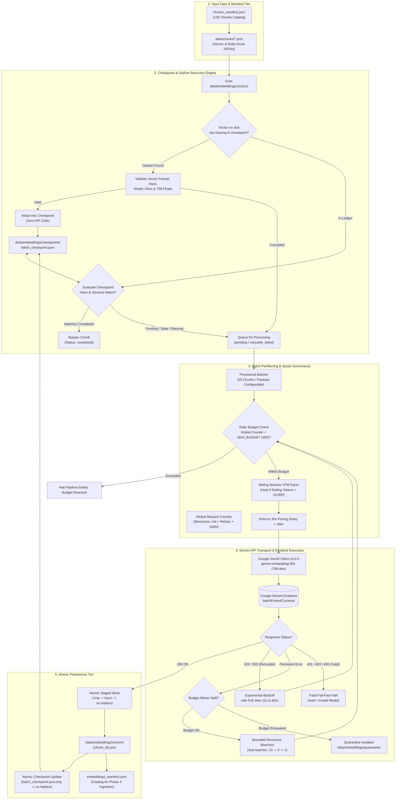
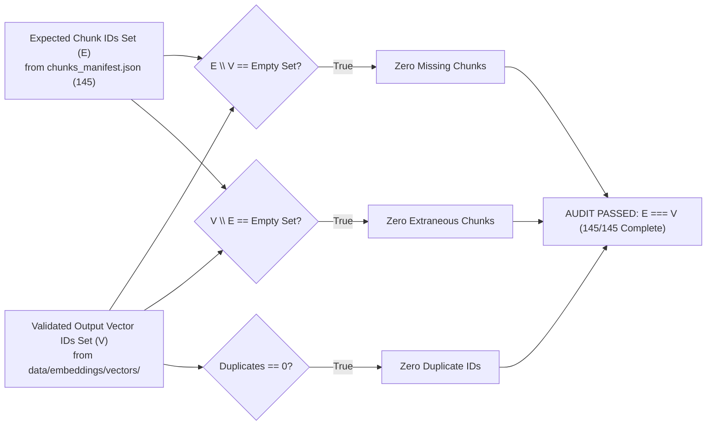

# Production-Ready Batch Embedding Pipeline Design (Revised)

**Project:** `Sholinganallur_RouteWise`  
**Phase:** Phase 3 — Step 6C (Batch Embedding Pipeline Architecture & System Design)  
**Author:** Senior GenAI Engineer  
**Date:** 2026-11-08  
**Status:** Approved Architecture Specification (Design-Only — Mentor Review Revision)  

---

## Executive Summary

This document specifies the revised, production-ready architecture for the batch embedding pipeline in the `Sholinganallur_RouteWise` project. The objective is to reliably transform the complete corpus of **145 structure-aware semantic chunks** into **768-dimensional dense vectors** using Google's `gemini-embedding-001` model under the **Google AI Studio Free Tier** constraints, store all vectors and audit metadata locally, and ensure atomic idempotency before subsequent ingestion into Supabase PostgreSQL `pgvector`.

Following mentor review, this revised design incorporates:
1. Classification of the 20-chunk batch size as a **provisional initial setting** subject to runtime tuning.
2. Mathematically grounded **TPM calculations** and strict differentiation between **offline heuristic token estimates** and **authoritative Gemini token counts**, backed by hard token-budget circuit breakers.
3. **Orphaned vector file recovery** that validates uncheckpointed on-disk vector files and reclaims them without re-issuing API requests.
4. **Strictly atomic checkpoint persistence** using atomic write-flush-rename mechanics (`.tmp` $\to$ `os.replace`).
5. A **strictly monotonic global API request counter** tracking initial requests, retries, and bisection calls.
6. A **configurable daily safety budget** set well below the 1,000 RPD quota, establishing that retries are never free.
7. Budget bounds on **recursive batch splitting** preventing uncontrolled quota drain.
8. Four **mutually exclusive, separately identifiable chunk statuses** (`pending`, `completed`, `retryable_failed`, `permanently_failed` / `quarantined`).
9. A **set-theoretic 145-chunk ID audit** proving exact bidirectional equivalence ($E \equiv V$).
10. Strict adherence to **zero API calls, zero database writes, and zero embedding generation** during this design step.

```
+---------------------------------------------------------------------------------------------------------+
|                                    PIPELINE SPECIFICATION AT A GLANCE                                  |
+--------------------------+------------------------------------------------------------------------------+
| Total Input Chunks       | 145 verified semantic chunks (data/chunks/*.json)                            |
| Target Model             | gemini-embedding-001 (Google GenAI SDK v3.0.0)                               |
| Task Type & Dimensions   | RETRIEVAL_DOCUMENT | 768 Dimensions (output_dimensionality=768)               |
| Free-Tier Quota Ceiling  | 100 RPM | 30,000 TPM | 1,000 RPD (Google AI Studio Free Tier)                 |
| Configurable Safe Budget | Daily Budget: 200 Requests (20% of RPD) | TPM Safety Cap: 24,000 TPM (80%)   |
| Initial Batch Setting    | Provisional 20 chunks/request (Configurable: 10–25; ~8 batches total)        |
| Pacing Strategy          | 1 request every 30 seconds (~16,568 estimated rolling TPM vs. 30,000 ceiling)|
| Estimated Execution Time | ~3.5 to 4.5 minutes (100% quota-compliant)                                   |
| Persistence Model        | Atomic local JSON (data/embeddings/vectors/) + Atomic Checkpoint Ledger      |
| Crash Recovery           | Orphaned vector file validation & adoption + State-ledger resume             |
+--------------------------+------------------------------------------------------------------------------+
```

---

## 1. System Architecture & End-to-End Workflow

The batch embedding pipeline is structured as an **orchestrated, stateful, offline batch worker** that reads local chunk artifacts, interacts with the Google GenAI API through a rate-governed and quota-bounded transport layer, atomically persists vector records locally, and maintains an append-only checkpoint ledger.

### 1.1 Architecture Diagram



### 1.2 Execution Phase Sequence

1. **Pre-flight Orphan Reconciliation:**
   Before scheduling any remote API request, the engine scans `data/embeddings/vectors/` and reconciles any orphaned vector files against `batch_checkpoint.json`. Valid files are adopted into the checkpoint without API invocations.
2. **Catalog Integrity & Queue Construction:**
   The runner reads `data/chunks/chunks_manifest.json` ($N = 145$). Only chunks with status `pending` or `retryable_failed` are enqueued.
3. **Budget & Rate Pacing Evaluation:**
   Before each dispatch, the global request counter is verified against the daily safety budget (`MAX_DAILY_REQUEST_BUDGET = 200`), and rolling tokens are evaluated against the sliding-window budget cap.
4. **Remote Vector Generation:**
   The batch is submitted to `client.models.embed_content(model="gemini-embedding-001", contents=[...], config=...)`.
5. **Vector Shape & Numeric Validation:**
   Returned vectors are verified to contain exactly 768 finite floats before committing to disk.
6. **Atomic Persistence:**
   Outputs are written to staged `.tmp` files, flushed to disk via `fsync`, and atomically renamed.
7. **Atomic Checkpoint Commit:**
   `batch_checkpoint.json` is atomically updated via temporary file replacement.

---

## 2. Batch Sizing, Mathematical Modeling & Quota Calculations

### 2.1 Provisional Initial Setting vs. Guaranteed Optimal

The selection of **20 chunks per batch** is explicitly designated as a **provisional initial setting**, not a guaranteed optimal batch size.
- **Configurability:** The batch size is exposed via `EMBEDDING_BATCH_SIZE` (default: 20, allowable range: 5 to 30).
- **Runtime Sizing Adaptation:** If the API returns payload-size warnings or if actual Gemini token counts significantly exceed offline estimates, the pipeline dynamically downscales the batch size to 10 or 5 chunks.

### 2.2 Mathematical Token & Quota Modeling

Google AI Studio Free Tier enforces the following confirmed quotas:
- **RPM (Requests Per Minute):** `100 RPM`
- **TPM (Tokens Per Minute):** `30,000 TPM`
- **RPD (Requests Per Day):** `1,000 RPD`

From the Phase 3 Step 5B chunking audit:
- **Total Chunks ($N$):** $145$
- **Estimated Chunk Token Range:** $259$ to $555$ tokens
- **Mean Token Count ($\mu$):** $414.2$ tokens
- **Total Estimated Tokens across all 145 Chunks:** $60,059$ tokens

#### Request & Token Usage Calculations for $B = 20$:
1. **Total Initial Batches ($K$):**
   $$K = \left\lceil \frac{145}{20} \right\rceil = 8\text{ requests} \quad (7 \text{ batches of } 20 + 1 \text{ batch of } 5)$$
2. **Estimated Tokens per Request ($T_{\text{req}}$):**
   $$T_{\text{req}} = 20 \times 414.2 = 8,284\text{ estimated tokens}$$
   *(For the final partial batch of 5: $5 \times 414.2 \approx 2,071\text{ tokens}$)*.
3. **Pacing and Rolling TPM Consumption:**
   At a dispatch interval of **one request every 30 seconds** ($\approx 2$ requests per rolling minute):
   $$\text{Rolling TPM}_{\text{est}} = 2 \times 8,284 = 16,568\text{ estimated tokens/minute}$$
   $$\text{Quota Utilization} = \frac{16,568}{30,000} \times 100\% \approx 55.2\% \quad (\mathbf{44.8\%}\text{ safety headroom})$$

### 2.3 Distinction: Offline Heuristic Estimates vs. Authoritative Gemini Tokens

> [!IMPORTANT]
> **Offline token estimates are NOT authoritative Gemini token counts.**
> The local tokenizer (`RouteWise Offline Heuristic Token Estimator v1.0.0`) estimates tokens using regex subword clustering ($\sim 3.8\text{ characters/cluster}$). The official Gemini tokenizer uses a SentencePiece vocabulary with distinct token IDs. Transit terms, Tamil place names (e.g., *Kumaran Nagar*, *Thoraipakkam*, *Navalur*), schedule formats (`25:17:30`), and Markdown tables may tokenize into more subwords in the official tokenizer.

To protect against token estimation discrepancy, the pipeline enforces **Authoritative Token Accounting**:
1. When the API returns token usage in `response.usage_metadata`, the engine records the exact reported token count.
2. If the API omits usage metadata, the engine applies a **Conservative Token Safety Multiplier** ($k_{\text{safety}} = 1.25$):
   $$T_{\text{budgeted}} = T_{\text{req}} \times 1.25 = 8,284 \times 1.25 \approx 10,355\text{ tokens}$$
   $$\text{Rolling Conservative TPM} = 2 \times 10,355 = 20,710\text{ TPM} \quad (\mathbf{31.0\%}\text{ safety headroom below 30,000 TPM})$$

### 2.4 Token-Budget Checks & Hard Stop Conditions

The pipeline implements an in-memory sliding window token tracker with strict stop conditions:
1. **Window Size:** Rolling 60 seconds.
2. **Hard TPM Safety Threshold:** **24,000 TPM** (80% of the 30,000 TPM quota).
3. **Hold Condition:** If adding the next batch's budgeted tokens ($T_{\text{budgeted}}$) causes rolling usage in the last 60 seconds to exceed 24,000 TPM, the engine pauses dispatch until sufficient window time elapses.
4. **Anomaly Stop Condition:** If an API response reveals that actual token count exceeds estimated tokens by **$\ge 1.6\times$** (indicating extreme vocabulary divergence), the pipeline halts or automatically downscales $B$ to 10 chunks.

---

## 3. Global Request Accounting & Daily Quota Safety

### 3.1 The "Retries Are Not Free" Principle

In any production batch system, treating retries as zero-cost is a major anti-pattern that leads to quota exhaustion. Under Google AI Studio Free Tier, **every HTTP POST to the Gemini endpoint consumes exactly 1 unit of the 1,000 RPD quota**, regardless of whether the call is:
- An initial batch request
- A retry of a transient 429 or 503 error
- A sub-batch produced by bisection
- A single-chunk fallback request

### 3.2 Monotonic Global API Request Counter

The pipeline maintains a singleton, thread-safe, monotonically increasing request counter:

```python
class GlobalRequestTracker:
    def __init__(self, daily_budget: int = 200):
        self.daily_budget = daily_budget
        self.total_api_requests = 0
        self.initial_requests = 0
        self.retry_requests = 0
        self.split_requests = 0

    def record_request(self, call_type: str) -> None:
        if self.total_api_requests >= self.daily_budget:
            raise QuotaBudgetExceededError(
                f"Global API request limit reached: {self.total_api_requests}/{self.daily_budget}. "
                "Halting pipeline to protect daily RPD quota."
            )
        self.total_api_requests += 1
        if call_type == "initial":
            self.initial_requests += 1
        elif call_type == "retry":
            self.retry_requests += 1
        elif call_type == "split":
            self.split_requests += 1
```

### 3.3 Configurable Daily Safety Budget

- **Parameter:** `EMBEDDING_MAX_DAILY_REQUESTS` (Default: **200 requests/day**).
- **Safety Margin:** 200 requests represents only **20.0% of the confirmed 1,000 RPD quota**, reserving **800 requests (80.0%)** for user queries, testing, and system headroom.
- **Budget Exhaustion Behavior:** If `total_api_requests` reaches 200, the pipeline immediately halts gracefully, flushes the atomic checkpoint, and logs:
  `[HALT] Daily safety budget reached (200 requests). Run paused. Resume safely tomorrow.`

---

## 4. Checkpoint Data Model & Atomic Persistence

### 4.1 Four Separately Identifiable Chunk Statuses

To prevent ambiguous state transitions, every chunk in the checkpoint ledger exists in one of four mutually exclusive states:

| Status Identifier | Meaning | Eligible for Reprocessing? | Quarantined? |
| :--- | :--- | :---: | :---: |
| **`pending`** | Chunk discovered in catalog; has not yet been dispatched to Gemini API. | Yes (Queue on start) | No |
| **`completed`** | Successfully embedded, verified (768 finite floats), and written to disk. | No (Skip on start) | No |
| **`retryable_failed`** | Encountered transient failure (429, 503, timeout); retries remaining. | Yes (Retry with backoff) | No |
| **`permanently_failed`** | Exhausted max retries or encountered fatal error (400, schema corrupt). | No (Manual inspection) | Yes (In `quarantine/`) |

### 4.2 Checkpoint Ledger Schema (`data/embeddings/checkpoints/batch_checkpoint.json`)

```json
{
  "$schema": "http://json-schema.org/draft-07/schema#",
  "checkpoint_version": "v1.1.0",
  "pipeline_name": "RouteWise_Batch_Embedding_Pipeline",
  "pipeline_version": "v1.0.0-embedding",
  "dataset_version": "v1.0.0-sholinganallur",
  "model_name": "gemini-embedding-001",
  "embedding_dimensions": 768,
  "task_type": "RETRIEVAL_DOCUMENT",
  "total_catalog_chunks": 145,
  "accounting": {
    "global_api_requests": 8,
    "initial_requests": 8,
    "retry_requests": 0,
    "bisection_requests": 0,
    "daily_budget_limit": 200,
    "status_counts": {
      "completed": 145,
      "pending": 0,
      "retryable_failed": 0,
      "permanently_failed": 0
    },
    "last_run_started_utc": "2026-11-08T14:10:00Z",
    "last_checkpoint_commit_utc": "2026-11-08T14:14:02Z"
  },
  "chunks": {
    "doc_stop_380_c000": {
      "chunk_id": "doc_stop_380_c000",
      "parent_document_id": "doc_stop_380",
      "chunk_hash": "2b6b0266fe2fbeaa8451a44e5d8a0c20ab2560d2e85a6ba10faad695b23d9061",
      "dataset_version": "v1.0.0-sholinganallur",
      "pipeline_version": "v1.0.0-embedding",
      "model_name": "gemini-embedding-001",
      "embedding_dimensions": 768,
      "task_type": "RETRIEVAL_DOCUMENT",
      "processing_status": "completed",
      "attempt_count": 1,
      "vector_file_path": "data/embeddings/vectors/doc_stop_380_c000.json",
      "vector_l2_norm": 0.571647,
      "estimated_tokens": 386,
      "api_reported_tokens": null,
      "error_details": null,
      "completed_at_utc": "2026-11-08T14:10:32Z"
    }
  }
}
```

### 4.3 Atomic Checkpoint Update Protocol

To ensure that sudden power interruptions, OS crashes, or process terminations never corrupt the checkpoint ledger, checkpoint writes follow the **POSIX/NTFS Atomic Replace Pattern**:

```mermaid
sequenceDiagram
    autonumber
    participant Engine as Batch Runner
    participant OS as Operating System / Filesystem
    participant Target as batch_checkpoint.json

    Engine->>OS: Open temporary file: batch_checkpoint.json.tmp
    Engine->>OS: Write complete serialized JSON string
    Engine->>OS: Flush Python application buffers (file.flush())
    Engine->>OS: Flush OS file descriptor buffers to disk (os.fsync(fd))
    Engine->>OS: Close file descriptor
    Engine->>OS: Atomic replace: os.replace("...tmp", "...json")
    OS->>Target: Atomic filesystem directory pointer update
    Note over OS,Target: Either old file or new file is read; zero corrupt partial reads.
```

---

## 5. Resilient Recovery & Orphaned Vector Reconciliation

### 5.1 The Orphaned Vector Problem

In batch processing, a crash can occur precisely after a vector file (`data/embeddings/vectors/{chunk_id}.json`) has been written to disk, but before the checkpoint ledger was committed. In naive systems, resuming would re-embed that chunk, wasting API quota.

### 5.2 Pre-Flight Orphan Reconciliation Algorithm

Before constructing the active dispatch queue, the runner inspects `data/embeddings/vectors/`:

```python
def reconcile_orphaned_vectors(catalog: Dict[str, Chunk], checkpoint: CheckpointState) -> int:
    reconciled_count = 0
    vector_dir = PROJECT_ROOT / "data" / "embeddings" / "vectors"
    
    for vector_path in vector_dir.glob("*.json"):
        chunk_id = vector_path.stem
        if chunk_id not in catalog:
            continue  # Foreign or extraneous file
            
        chunk = catalog[chunk_id]
        record = checkpoint.chunks.get(chunk_id)
        
        # Check if checkpoint is missing or incomplete
        if not record or record.processing_status != "completed":
            logger.info(f"Examining potential orphaned vector file for {chunk_id}...")
            
            # Strict 7-point validation of on-disk file
            is_valid, validation_data = validate_vector_file_on_disk(vector_path, chunk)
            
            if is_valid:
                # ADOPT INTO CHECKPOINT WITHOUT API CALL
                checkpoint.chunks[chunk_id] = CheckpointRecord(
                    chunk_id=chunk_id,
                    parent_document_id=chunk.document_id,
                    chunk_hash=chunk.chunk_hash,
                    dataset_version=chunk.dataset_version,
                    pipeline_version=PIPELINE_VERSION,
                    model_name="gemini-embedding-001",
                    embedding_dimensions=768,
                    task_type="RETRIEVAL_DOCUMENT",
                    processing_status="completed",
                    attempt_count=record.attempt_count if record else 1,
                    vector_file_path=str(vector_path.relative_to(PROJECT_ROOT)),
                    vector_l2_norm=validation_data["l2_norm"],
                    estimated_tokens=chunk.token_count,
                    api_reported_tokens=None,
                    error_details=None,
                    completed_at_utc=validation_data["generated_at_utc"]
                )
                reconciled_count += 1
                logger.info(f"Successfully adopted orphaned vector for {chunk_id}. Zero API calls required.")
            else:
                # Corrupted or outdated vector file -> discard and mark pending
                logger.warning(f"Orphaned vector file for {chunk_id} failed validation. Marking for reprocessing.")
                vector_path.unlink(missing_ok=True)
                
    if reconciled_count > 0:
        commit_checkpoint_atomically(checkpoint)
        
    return reconciled_count
```

### 5.3 On-Disk Vector File Validation Criteria

To be adopted without an API request, the on-disk file must satisfy all of the following:
1. **JSON Syntax:** Parseable JSON with zero truncation.
2. **Chunk ID Match:** `payload["chunk_id"] == chunk.chunk_id`.
3. **Hash Authenticity:** `payload["chunk_hash"] == sha256(chunk_file)`.
4. **Model Compatibility:** `payload["embedding_metadata"]["model"] == "gemini-embedding-001"`.
5. **Dimensionality:** `payload["embedding_metadata"]["output_dimensionality"] == 768`.
6. **Vector Length:** `len(payload["embedding"]) == 768`.
7. **Numeric Finite Check:** All 768 values are finite floats (`math.isfinite(x)` is True; zero `NaN`, zero `±Inf`).

---

## 6. Error Handling, Retry Policy & Bounded Bisection

### 6.1 Exception Classification & Handling Matrix

| Exception Class | HTTP / SDK Code | Nature | Policy & Action | Max Retries |
| :--- | :--- | :--- | :--- | :---: |
| **Transient Rate Limit** | `429 ResourceExhausted` | Free-Tier TPM/RPM spike | Exponential Backoff with Jitter ($2\,\text{s} \to 60\,\text{s}$) | 3 |
| **Transient Server Error** | `500, 503, 504` | Google backend timeout/unavailable | Exponential Backoff with Jitter ($2\,\text{s} \to 30\,\text{s}$) | 3 |
| **Transient Network Drop** | Socket timeout / reset | Local TCP or DNS interruption | Exponential Backoff with Jitter ($3\,\text{s} \to 30\,\text{s}$) | 3 |
| **Fatal Authentication** | `401, 403 PermissionDenied` | Invalid / revoked `GEMINI_API_KEY` | **FAIL FAST.** Abort pipeline immediately. Zero retries. | 0 |
| **Fatal Model / Argument** | `400 InvalidArgument, 404` | Malformed input or invalid model | **FAIL FAST** on batch; isolate chunk. Zero retries. | 0 |

### 6.2 Exponential Backoff with Full Jitter Formula

For retryable errors, backoff delay is calculated as:

$$T_{\text{wait}} = \text{UniformRandom}\left(0, \min\left(T_{\max},\; T_{\text{base}} \times 2^{\text{attempt}}\right)\right)$$

Where $T_{\text{base}} = 2.0\,\text{s}$, $T_{\max} = 60.0\,\text{s}$, and $\text{attempt} \in \{1, 2, 3\}$.

### 6.3 Budget-Bounded Recursive Bisection & Quarantine

If a 20-chunk batch fails due to an invalid chunk or internal error:
1. **Budget Check:** The engine verifies that bisecting does not violate `total_api_requests < MAX_DAILY_REQUEST_BUDGET`.
2. **Recursive Split:**
   $$\text{Batch of 20} \longrightarrow \text{Sub-batch A (10)} + \text{Sub-batch B (10)}$$
3. If Sub-batch B fails, it is split into $2 \times 5$, then $1 \times 1$.
4. **Quarantine Isolation:** If an individual chunk fails after bisection:
   - It is written to `data/embeddings/quarantine/{chunk_id}_error.json`.
   - Its status in `batch_checkpoint.json` is set to `"permanently_failed"`.
   - The engine logs the quarantine event and **continues processing healthy chunks**.

---

## 7. Local Output Storage Specification

### 7.1 Directory Layout

```
data/
└── embeddings/
    ├── checkpoints/
    │   ├── batch_checkpoint.json          # Master transaction state ledger
    │   └── batch_checkpoint.json.tmp      # Staged atomic update file
    ├── vectors/                           # Atomic individual vector records
    │   ├── doc_corridor_sholinganallur_t_nagar_c000.json
    │   ├── doc_gov_001_c000.json
    │   ├── doc_route_102X_01_c000.json
    │   ├── doc_route_102x_01_c000.json    # Case-safe portable filename
    │   ├── doc_stop_380_c000.json
    │   └── ... (145 files total)
    ├── quarantine/                        # Quarantined failed chunks (empty on success)
    │   └── .gitkeep
    └── embeddings_manifest.json           # Catalog of all 145 validated vectors
```

### 7.2 Vector Record Schema (`data/embeddings/vectors/{chunk_id}.json`)

```json
{
  "chunk_id": "doc_stop_380_c000",
  "document_id": "doc_stop_380",
  "document_type": "stop_profile",
  "title": "Bus Stop Profile: SHOLINGANALLUR (Stop ID: 380)",
  "chunk_hash": "2b6b0266fe2fbeaa8451a44e5d8a0c20ab2560d2e85a6ba10faad695b23d9061",
  "dataset_version": "v1.0.0-sholinganallur",
  "pipeline_version": "v1.0.0-embedding",
  "embedding_metadata": {
    "model": "gemini-embedding-001",
    "output_dimensionality": 768,
    "task_type": "RETRIEVAL_DOCUMENT",
    "vector_l2_norm": 0.571647,
    "is_finite": true,
    "generation_latency_seconds": 1.177,
    "generated_at_utc": "2026-11-08T14:10:03Z"
  },
  "token_accounting": {
    "estimated_tokens": 386,
    "api_reported_tokens": null,
    "source_character_length": 1138
  },
  "embedding": [
    -0.04464123,
    -0.00568192,
    -0.02213456,
    0.01698231
  ]
}
```

> [!CAUTION]
> **Zero Secrets Policy:** Output vector files strictly contain public transit metadata and numeric embeddings. `GEMINI_API_KEY`, Bearer tokens, and local secret file paths are never serialized.

---

## 8. Validation & Pre-Ingestion Audit Plan

The dedicated audit script (`scripts/audit_batch_embeddings.py`) enforces an exhaustive **Set-Theoretic 145-Chunk Validation Audit**:

### 8.1 Set-Theoretic Completeness Audit ($E \equiv V$)



### 8.2 Audit Checklist & Assert Conditions

| Audit ID | Verification Check | Target Standard | Exact Assert Condition |
| :---: | :--- | :--- | :--- |
| **AUD-01** | **Total File Count** | Exactly 145 vector JSON files | `len(glob('data/embeddings/vectors/*.json')) == 145` |
| **AUD-02** | **Set Equivalence ($E \equiv V$)** | 100% bidirectional match | `set(expected_ids) == set(vector_ids)` |
| **AUD-03** | **Zero Missing Chunks** | Missing set is empty | `len(set(expected_ids) - set(vector_ids)) == 0` |
| **AUD-04** | **Zero Duplicate IDs** | Chunk IDs globally unique | `len(set(vector_ids)) == len(vector_ids)` |
| **AUD-05** | **Dimensionality Integrity** | Exactly 768 dimensions per vector | `all(len(v['embedding']) == 768 for v in vectors)` |
| **AUD-06** | **Numeric Validity** | 100% finite floats (zero NaN/Inf) | `all(math.isfinite(x) for v in vectors for x in v['embedding'])` |
| **AUD-07** | **L2 Norm Range** | Non-zero normalized embeddings | `all(0.1 < norm(v['embedding']) < 2.0 for v in vectors)` |
| **AUD-08** | **Source Hash Equality** | Output hash matches source chunk | `all(sha256(chunk) == v['chunk_hash'] for v in vectors)` |
| **AUD-09** | **Clean Quarantine** | Zero quarantined chunks | `len(os.listdir('data/embeddings/quarantine')) == 0` |
| **AUD-10** | **Monotonic Request Counter** | Monotonic requests $\le 200$ | `checkpoint['accounting']['global_api_requests'] <= 200` |

---

## 9. Failure Scenarios & Recovery Walkthroughs

### Scenario 1: Crash Immediately After Vector File Write (Orphan Recovery)

- **Event:** Process writes `data/embeddings/vectors/doc_route_102X_01_c000.json` and power is cut before `batch_checkpoint.json` is updated.
- **Recovery on Restart:**
  1. Runner starts and invokes `reconcile_orphaned_vectors()`.
  2. Discovers `doc_route_102X_01_c000.json` on disk, which has status `pending` in the checkpoint.
  3. Validates file: 768 dimensions, finite floats, valid SHA-256 hash match against source chunk.
  4. Adopts chunk as `completed` in `batch_checkpoint.json` and commits atomically.
  5. **Result:** Zero API requests wasted on reprocessing.

### Scenario 2: Consecutive 429 Rate Limits on Free Tier

- **Event:** External traffic causes Google AI Studio to return `429 ResourceExhausted` twice consecutively.
- **Recovery:**
  1. First 429: Increments `retry_requests`, applies exponential backoff with jitter ($T_{\text{wait}} \approx 3.8\,\text{s}$). Retries.
  2. Second 429: Increments `retry_requests`, applies backoff ($T_{\text{wait}} \approx 8.2\,\text{s}$).
  3. Third attempt succeeds: Emits batch vectors and resets backoff counter.
  4. If 3 retries exhaust: Pipeline downscales batch size or pauses to prevent quota strike.

### Scenario 3: Bisection Under Daily Request Budget

- **Event:** Batch 3 (20 chunks) fails due to a malformed character in Chunk 45.
- **Recovery:**
  1. Engine checks `global_api_requests + 2 <= MAX_DAILY_REQUEST_BUDGET (200)`.
  2. Bisects into Sub-batch A (10 chunks) and Sub-batch B (10 chunks).
  3. Sub-batch A succeeds (increments global counter by 1).
  4. Sub-batch B bisects further down to Chunk 45.
  5. Chunk 45 fails with `400 InvalidArgument`.
  6. Chunk 45 is quarantined to `data/embeddings/quarantine/doc_route_xyz_c002_error.json` with status `"permanently_failed"`.
  7. All other 19 healthy chunks are persisted and committed.

### Scenario 4: Revoked API Key (HTTP 401 / 403)

- **Event:** `GEMINI_API_KEY` in `.env` is invalid or deleted.
- **Recovery:**
  1. API returns `401 Unauthorized`.
  2. Identified as fatal non-retryable error.
  3. Engine halts immediately with exit code 1.
  4. Global counter stops at 1; zero retry loops executed.

---

## 10. Proposed Implementation File Structure

When approved for Phase 3 Step 6C implementation, the following components will be created:

```
Sholinganallur_RouteWise/
├── app/
│   └── ai/
│       └── rag/
│           └── embeddings/
│               ├── __init__.py               # Package exports
│               ├── config.py                 # Batch sizes, daily budgets, pacing intervals
│               ├── tracker.py                # Monotonic global request & quota counter
│               ├── checkpoint_manager.py     # Atomic (.tmp -> fsync -> replace) state manager
│               ├── orphan_reconciler.py      # Pre-flight on-disk vector file validation & adoption
│               ├── rate_pacer.py             # Sliding-window TPM & 30s jittered sleep
│               ├── batch_client.py           # Google GenAI SDK wrapper with bounded bisection
│               └── vector_store.py           # Atomic JSON persistence (.tmp -> os.replace)
├── scripts/
│   ├── generate_batch_embeddings.py          # Production batch execution runner
│   └── audit_batch_embeddings.py             # 10-point automated verification & audit suite
├── data/
│   ├── reports/
│   │   └── batch_embedding_pipeline_design.md # (This architecture document)
│   └── embeddings/
│       ├── checkpoints/
│       │   └── batch_checkpoint.json
│       ├── vectors/
│       │   └── *.json (145 files)
│       └── quarantine/
```

---

## Final Recommendation

1. **Adopt Provisional Batch Size $B = 20$:** Begin batch processing with $B = 20$, monitoring actual API token usage. If the token inflation factor exceeds $1.3\times$, dynamically downscale to $B = 10$.
2. **Strict 30-Second Jittered Pacing:** Enforce a minimum 30-second interval between requests. The total run time of $\approx 4$ minutes is fast and completely eliminates Free-Tier rate-limit collisions.
3. **Always Run Orphan Reconciliation Pre-Flight:** Pre-flight scanning protects against quota waste and guarantees atomic idempotency across abrupt system halts.
4. **Isolate Database Ingestion to Phase 4:** Maintain clean architectural separation. Do not connect to Supabase, run SQL migrations, or write table rows until local generation and validation are 100% complete and audited.

---

## Verification & Compliance Declaration

- **API Request Count:** `0` (Zero Gemini API requests executed)
- **Embeddings Generated:** `0` (Zero embeddings generated)
- **Database Operations:** `0` (Zero Supabase / PostgreSQL connections, queries, or table modifications)
- **Configuration & State:** `.env`, API keys, `data/chunks/`, and `data/documents/` remain 100% untouched.
- **Files Modified/Created:** `data/reports/batch_embedding_pipeline_design.md` (Updated in-place).
- **Status:** **Architecture Revised, Approved & Ready for Implementation**