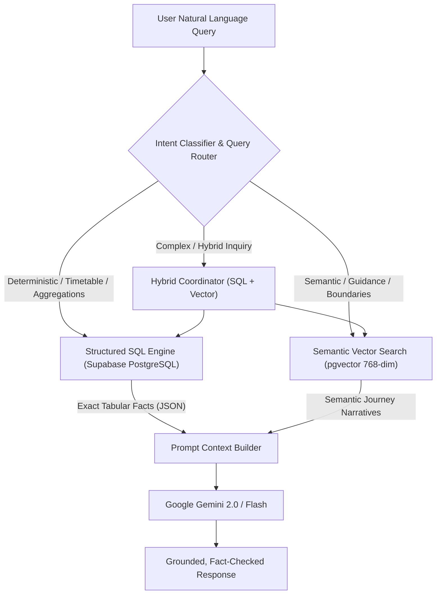
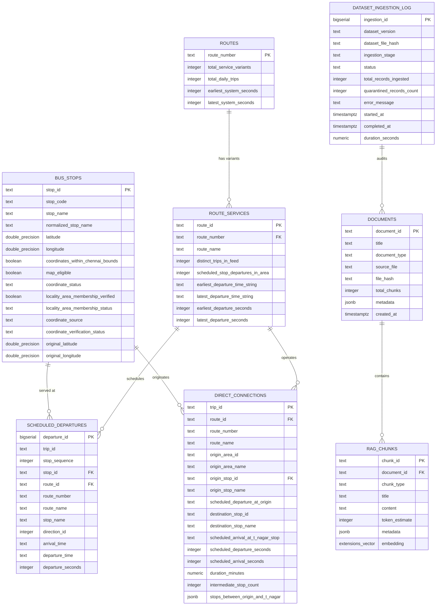

# Hybrid RAG Data Model & Document Preparation Design (Corrected)

**Project:** `Sholinganallur_RouteWise`  
**Phase:** Phase 3 — Step 3: Data Modelling and Document Preparation Design (Revision 2 — Rigorous Architectural Review)  
**Date:** 2026-11-08  
**Author:** Senior Database Architect & GenAI Engineer  
**Status:** Approved for Design Only (Zero DDL/DML Executed, Zero Application Code Modified)  

---

## 1. Executive Summary & Source Data Verification

The Sholinganallur Public Transport Assistant operates over a curated Chennai MTC GTFS extract for the **Sholinganallur transit corridor** (`area_id = 'sholinganallur'`).

A rigorous re-inspection of the six processed canonical JSON files in `data/processed/` was conducted to verify every single source attribute, primary key, and foreign key candidate before finalizing the relational and semantic data models:

| Processed File | Verified Record Count | Primary Key Candidate in Source | Key Source Attributes Verified |
|---|---|---|---|
| [`bus_stops.json`](file:///c:/Users/Kerthika%20M/Documents/AI%20Project/Sholinganallur_RouteWise/data/processed/bus_stops.json) | **26 stops** | `stop_id` (100% unique) | `stop_id`, `stop_code`, `stop_name`, `normalized_stop_name`, `latitude`, `longitude`, `coordinates_within_chennai_bounds`, `map_eligible`, `coordinate_status`, `locality_area_membership_verified`, `locality_area_membership_status`, `coordinate_source`, `coordinate_verification_status`, `original_latitude`, `original_longitude` |
| [`route_service_summary.json`](file:///c:/Users/Kerthika%20M/Documents/AI%20Project/Sholinganallur_RouteWise/data/processed/route_service_summary.json) | **278 service records** (representing **58 unique route numbers**) | `route_id` (100% unique) | `route_id`, `route_number`, `route_name`, `distinct_trips_in_feed`, `scheduled_stop_departures_in_area`, `earliest_departure_time_string`, `latest_departure_time_string`, `earliest_departure_seconds`, `latest_departure_seconds` |
| [`scheduled_departures.json`](file:///c:/Users/Kerthika%20M/Documents/AI%20Project/Sholinganallur_RouteWise/data/processed/scheduled_departures.json) | **18,439 departures** | Composite: `(trip_id, stop_sequence)` (100% unique) | `stop_id`, `stop_name`, `route_id`, `route_number`, `route_name`, `trip_id`, `direction_id`, `stop_sequence`, `arrival_time`, `departure_time`, `departure_seconds` |
| [`direct_t_nagar_connections.json`](file:///c:/Users/Kerthika%20M/Documents/AI%20Project/Sholinganallur_RouteWise/data/processed/direct_t_nagar_connections.json) | **170 direct trip runs** | `trip_id` (100% unique) | `origin_area_id`, `origin_area_name`, `trip_id`, `route_id`, `route_number`, `route_name`, `origin_stop_id`, `origin_stop_name`, `scheduled_departure_at_origin`, `destination_stop_id`, `destination_stop_name`, `scheduled_arrival_at_t_nagar_stop`, `scheduled_departure_seconds`, `scheduled_arrival_seconds`, `duration_minutes`, `intermediate_stop_count`, `stops_between_origin_and_t_nagar` |
| [`dataset_metadata.json`](file:///c:/Users/Kerthika%20M/Documents/AI%20Project/Sholinganallur_RouteWise/data/processed/dataset_metadata.json) | **1 object** | N/A (Canonical metadata) | Provenance, 8 documented limitations, coordinate patch policies, static timetable disclaimer |
| [`quarantined_records.json`](file:///c:/Users/Kerthika%20M/Documents/AI%20Project/Sholinganallur_RouteWise/data/processed/quarantined_records.json) | **2 records** | `id` (Stop IDs `380` and `168`) | Quarantined stops with placeholder coordinates (`map_eligible: false`) |

---

## 2. Hybrid RAG Architecture Design

Public transit systems present a fundamental data duality:
1. **Deterministic Structured Reality:** Commuters require exact timestamps, strict chronological ordering, exact route line numbers, and accurate stop sequences.
2. **Semantic Exploratory Reality:** Commuters require conversational descriptions of journeys, landmark context (e.g., passing Tidel Park and Madhya Kailash along OMR), area boundaries, and understanding of static GTFS schedule limitations.

### 2.1 Hybrid Execution Workflow



### 2.2 Query Routing Decision Matrix

| Query Intent Category | Primary Engine | Secondary Engine | Typical Query Patterns | Architectural Justification |
|---|---|---|---|---|
| **Timetable / Departure Lookups** | **SQL** | None | *"When is the next bus to Broadway?"*, *"First bus after 6:00 AM"* | Vector cosine distance cannot reliably perform numerical range filtering (`departure_seconds >= x`) or sort chronologically. Relational indexing handles this deterministically. |
| **Route Line Availability** | **SQL** | Vector | *"Which bus numbers connect Sholinganallur to Koyambedu?"* | Strict matching against normalized route numbers (`570`, `102`) and terminal destinations. |
| **Corridor Guidance & Journey Explanations** | **Vector** | SQL | *"Explain how to travel from Sholinganallur to T. Nagar"*, *"What landmarks will I pass?"* | High-level journey narrative retrieved via semantic similarity, optionally enriched with SQL departure frequency metrics. |
| **Stop Discovery & Proximity** | **SQL + Vector** | Vector | *"Which bus stops are near Kumaran Nagar?"*, *"Where can I board in Sholinganallur?"* | Hybrid combination: Vector search matches informal stop names/aliases; SQL retrieves validated coordinates and mapping eligibility. |
| **System Limitations & Live Tracking Disclaimers** | **Vector** | None | *"Is this bus delayed right now?"*, *"Can I see live GPS tracking?"* | Semantic matching against documented governance chunks explaining that RouteWise AI uses static GTFS timetables only. |

---

## 3. Route Data Model: Route Identity vs. Route Service Profile

A common flaw in naive GTFS modeling is collapsing **route identity** and **route service profile** into a single table. In Chennai MTC:
* **Route Identity (58 distinct entities):** Represents the public transit line that a commuter looks for on a bus board (e.g., Line `102`, Line `19`, Line `570`).
* **Route Service Profile (278 distinct entities):** Represents an operational origin-to-destination variant published in the GTFS feed with its own unique `route_id`.

For example, public route number `102` has multiple operational variants in Sholinganallur:
* `route_id = "3"`: `ADYAR B.T To SIRUSERI I.T PARK` (2 trips)
* `route_id = "7"`: `BROADWAY To KELAMBAKKAM B.T` (37 trips)
* `route_id = "333"`: `ADYAR DEPOT To KELAMBAKKAM` (6 trips)

### 3.1 Normalized Two-Table Architecture

To avoid data redundancy and prevent ambiguous queries, the schema normalizes route data into two related tables:

1. **`routes` (58 rows):**
   - **Primary Key:** `route_number TEXT PRIMARY KEY`
   - **Entity Meaning:** The canonical public bus route identity.
   - **Attributes:** Aggregate metrics across all variants (total daily trips, total variants, operational time bounds).
   - **Query Purpose:** Resolves high-level queries such as *"What bus routes serve Sholinganallur?"* without returning 278 confusing duplicate route lines.
2. **`route_services` (278 rows):**
   - **Primary Key:** `route_id TEXT PRIMARY KEY`
   - **Foreign Key:** `route_number TEXT REFERENCES routes(route_number) ON DELETE CASCADE`
   - **Entity Meaning:** The specific terminal-to-terminal operational variant.
   - **Attributes:** `route_name`, `distinct_trips_in_feed`, `scheduled_stop_departures_in_area`, `earliest_departure_seconds`, `latest_departure_seconds`.
   - **Query Purpose:** Resolves variant-specific inquiries, terminal destinations, and connects directly to `scheduled_departures` and `direct_connections`.

---

## 4. Supabase PostgreSQL Schema Specification

### 4.1 Corrected Entity Relationship Diagram



---

### 4.2 Complete DDL Definitions

#### Table 1: `routes` (58 rows — Public Route Line Identities)
```sql
CREATE TABLE IF NOT EXISTS routes (
    route_number TEXT PRIMARY KEY,
    total_service_variants INTEGER NOT NULL,
    total_daily_trips INTEGER NOT NULL,
    earliest_system_seconds INTEGER NOT NULL,
    latest_system_seconds INTEGER NOT NULL,
    created_at TIMESTAMPTZ NOT NULL DEFAULT timezone('utc', now())
);
```

#### Table 2: `route_services` (278 rows — Operational Service Profiles)
```sql
CREATE TABLE IF NOT EXISTS route_services (
    route_id TEXT PRIMARY KEY,
    route_number TEXT NOT NULL REFERENCES routes(route_number) ON DELETE CASCADE,
    route_name TEXT NOT NULL,
    distinct_trips_in_feed INTEGER NOT NULL,
    scheduled_stop_departures_in_area INTEGER NOT NULL,
    earliest_departure_time_string TEXT NOT NULL,
    latest_departure_time_string TEXT NOT NULL,
    earliest_departure_seconds INTEGER NOT NULL,
    latest_departure_seconds INTEGER NOT NULL,
    created_at TIMESTAMPTZ NOT NULL DEFAULT timezone('utc', now())
);

CREATE INDEX IF NOT EXISTS idx_route_services_number ON route_services (route_number);
CREATE INDEX IF NOT EXISTS idx_route_services_dep_bounds ON route_services (earliest_departure_seconds, latest_departure_seconds);
```

#### Table 3: `bus_stops` (26 rows — Sholinganallur Area Stops)
```sql
CREATE TABLE IF NOT EXISTS bus_stops (
    stop_id TEXT PRIMARY KEY,
    stop_code TEXT NOT NULL,
    stop_name TEXT NOT NULL,
    normalized_stop_name TEXT NOT NULL,
    latitude DOUBLE PRECISION NULL,
    longitude DOUBLE PRECISION NULL,
    coordinates_within_chennai_bounds BOOLEAN NOT NULL DEFAULT TRUE,
    map_eligible BOOLEAN NOT NULL DEFAULT TRUE,
    coordinate_status TEXT NOT NULL,
    locality_area_membership_verified BOOLEAN NOT NULL DEFAULT FALSE,
    locality_area_membership_status TEXT NOT NULL,
    coordinate_source TEXT NOT NULL,
    coordinate_verification_status TEXT NOT NULL,
    original_latitude DOUBLE PRECISION NULL,
    original_longitude DOUBLE PRECISION NULL,
    created_at TIMESTAMPTZ NOT NULL DEFAULT timezone('utc', now())
);

CREATE INDEX IF NOT EXISTS idx_bus_stops_normalized_name ON bus_stops (normalized_stop_name);
CREATE INDEX IF NOT EXISTS idx_bus_stops_coords ON bus_stops (latitude, longitude) WHERE map_eligible = TRUE;
```

#### Table 4: `scheduled_departures` (18,439 rows — Time-Indexed Departures)
```sql
CREATE TABLE IF NOT EXISTS scheduled_departures (
    departure_id BIGSERIAL PRIMARY KEY,
    trip_id TEXT NOT NULL,
    stop_sequence INTEGER NOT NULL,
    stop_id TEXT NOT NULL REFERENCES bus_stops(stop_id) ON DELETE CASCADE,
    route_id TEXT NOT NULL REFERENCES route_services(route_id) ON DELETE CASCADE,
    route_number TEXT NOT NULL,
    route_name TEXT NOT NULL,
    stop_name TEXT NOT NULL,
    direction_id INTEGER NOT NULL,
    arrival_time TEXT NOT NULL,
    departure_time TEXT NOT NULL,
    departure_seconds INTEGER NOT NULL,
    created_at TIMESTAMPTZ NOT NULL DEFAULT timezone('utc', now()),
    CONSTRAINT uq_scheduled_departures_trip_seq UNIQUE (trip_id, stop_sequence)
);

-- Compound index optimizing stop timetable range scans (e.g., departures after 08:00 AM)
CREATE INDEX IF NOT EXISTS idx_sched_deps_stop_time ON scheduled_departures (stop_id, departure_seconds);
-- Compound index optimizing route-level departure filtering
CREATE INDEX IF NOT EXISTS idx_sched_deps_route_time ON scheduled_departures (route_id, departure_seconds);
-- Index supporting line number queries
CREATE INDEX IF NOT EXISTS idx_sched_deps_route_number ON scheduled_departures (route_number);
-- Index supporting origin trip queries (stop_sequence = 1)
CREATE INDEX IF NOT EXISTS idx_sched_deps_origin_seq ON scheduled_departures (stop_sequence, departure_seconds);
```

#### Table 5: `direct_connections` (170 rows — Verified Source Attributes Only)
```sql
CREATE TABLE IF NOT EXISTS direct_connections (
    trip_id TEXT PRIMARY KEY,
    route_id TEXT NOT NULL REFERENCES route_services(route_id) ON DELETE CASCADE,
    route_number TEXT NOT NULL,
    route_name TEXT NOT NULL,
    origin_area_id TEXT NOT NULL,
    origin_area_name TEXT NOT NULL,
    origin_stop_id TEXT NOT NULL REFERENCES bus_stops(stop_id) ON DELETE CASCADE,
    origin_stop_name TEXT NOT NULL,
    scheduled_departure_at_origin TEXT NOT NULL,
    destination_stop_id TEXT NOT NULL,
    destination_stop_name TEXT NOT NULL,
    scheduled_arrival_at_t_nagar_stop TEXT NOT NULL,
    scheduled_departure_seconds INTEGER NOT NULL,
    scheduled_arrival_seconds INTEGER NOT NULL,
    duration_minutes NUMERIC(5, 2) NOT NULL,
    intermediate_stop_count INTEGER NOT NULL,
    stops_between_origin_and_t_nagar JSONB NOT NULL,
    created_at TIMESTAMPTZ NOT NULL DEFAULT timezone('utc', now())
);

CREATE INDEX IF NOT EXISTS idx_direct_conns_origin_dest ON direct_connections (origin_stop_id, destination_stop_id);
CREATE INDEX IF NOT EXISTS idx_direct_conns_dep_sec ON direct_connections (scheduled_departure_seconds);
CREATE INDEX IF NOT EXISTS idx_direct_conns_gin_stops ON direct_connections USING gin (stops_between_origin_and_t_nagar);
```
> [!IMPORTANT]
> **Constraint Verification on `destination_stop_id`:**  
> `origin_stop_id` references `bus_stops(stop_id)` because boarding stops reside in Sholinganallur. However, `destination_stop_id` (`bZroqIhX` "CIT NAGAR" and "THYAGARAYA NAGAR") resides in T. Nagar (outside the Sholinganallur extract). Therefore, `destination_stop_id` is defined as `TEXT NOT NULL` without a foreign key to `bus_stops`, preserving referential integrity without rejecting external destination stops.

#### Table 6: `dataset_ingestion_log` (ETL Ingestion & Audit Trail)
```sql
CREATE TABLE IF NOT EXISTS dataset_ingestion_log (
    ingestion_id BIGSERIAL PRIMARY KEY,
    dataset_version TEXT NOT NULL,
    dataset_file_hash TEXT NOT NULL,
    ingestion_stage TEXT NOT NULL,
    status TEXT NOT NULL,
    total_records_ingested INTEGER NOT NULL DEFAULT 0,
    quarantined_records_count INTEGER NOT NULL DEFAULT 0,
    error_message TEXT NULL,
    started_at TIMESTAMPTZ NOT NULL DEFAULT timezone('utc', now()),
    completed_at TIMESTAMPTZ NULL,
    duration_seconds NUMERIC(8, 2) NULL
);

CREATE INDEX IF NOT EXISTS idx_ingestion_log_hash_status ON dataset_ingestion_log (dataset_file_hash, status);
```

#### Table 7: `documents` (RAG Knowledge Document Manifest)
```sql
CREATE TABLE IF NOT EXISTS documents (
    document_id TEXT PRIMARY KEY,
    title TEXT NOT NULL,
    document_type TEXT NOT NULL,
    source_file TEXT NOT NULL,
    file_hash TEXT NOT NULL,
    total_chunks INTEGER NOT NULL DEFAULT 1,
    metadata JSONB NOT NULL DEFAULT '{}'::jsonb,
    created_at TIMESTAMPTZ NOT NULL DEFAULT timezone('utc', now())
);

CREATE INDEX IF NOT EXISTS idx_documents_type ON documents (document_type);
```

#### Table 8: `rag_chunks` (Semantic Chunks with 768-dim Vector Embeddings)
```sql
CREATE TABLE IF NOT EXISTS rag_chunks (
    chunk_id TEXT PRIMARY KEY,
    document_id TEXT NOT NULL REFERENCES documents(document_id) ON DELETE CASCADE,
    chunk_type TEXT NOT NULL,
    title TEXT NOT NULL,
    content TEXT NOT NULL,
    token_estimate INTEGER NOT NULL,
    metadata JSONB NOT NULL DEFAULT '{}'::jsonb,
    embedding extensions.vector(768) NOT NULL,
    created_at TIMESTAMPTZ NOT NULL DEFAULT timezone('utc', now())
);

CREATE INDEX IF NOT EXISTS idx_rag_chunks_hnsw 
ON rag_chunks USING hnsw (embedding extensions.vector_cosine_ops);

CREATE INDEX IF NOT EXISTS idx_rag_chunks_type ON rag_chunks (chunk_type);
CREATE INDEX IF NOT EXISTS idx_rag_chunks_metadata ON rag_chunks USING gin (metadata);
```

### 4.3 Supabase pgvector Extension Schema Analysis

* **Verified Audit Finding:** In Supabase PostgreSQL, extension `vector` is installed in schema **`extensions`** (`('vector', '0.8.2', 'extensions')`).
* **Python Client Registration (`psycopg`):**  
  `pgvector.psycopg.register_vector_async(conn)` queries `pg_type` for type name `'vector'` across all schemas. It registers the vector OID seamlessly regardless of which schema contains the extension.
* **SQL DDL & DML Schema Qualification:**  
  To avoid errors when `extensions` is not in a user's default `search_path`, all DDL statements explicitly qualify the vector type and operator class:
  ```sql
  embedding extensions.vector(768) NOT NULL
  USING hnsw (embedding extensions.vector_cosine_ops)
  ```

---

## 5. Indexing Design & Performance Realities

> [!NOTE]
> Database performance is not guaranteed theoretically; actual latency and throughput depend on Supabase compute tier, allocated shared buffers, disk I/O, network round-trip time, and concurrent client connections. Production performance must be benchmarked using `EXPLAIN (ANALYZE, BUFFERS)`.

The proposed schema utilizes targeted indexing strategies to optimize specific query access patterns:

1. **Composite B-Tree Indexes on Departures (`idx_sched_deps_stop_time`):**
   - **Pattern:** `WHERE stop_id = ? AND departure_seconds BETWEEN ? AND ? ORDER BY departure_seconds ASC`
   - **Optimization:** Allows PostgreSQL to perform an index seek directly to the `stop_id`, then a narrow index range scan along the ordered `departure_seconds` keys, avoiding full table scans of 18,439 rows.
2. **Partial Geospatial Index (`idx_bus_stops_coords`):**
   - **Pattern:** `WHERE map_eligible = TRUE AND latitude IS NOT NULL`
   - **Optimization:** Keeps the index compact by excluding quarantined stops that have null coordinates, ensuring spatial bounding-box lookups only evaluate verified coordinates.
3. **GIN Index on Intermediate JSONB Stops (`idx_direct_conns_gin_stops`):**
   - **Pattern:** `WHERE stops_between_origin_and_t_nagar @> '[{"stop_name": "TIDEL PARK"}]'`
   - **Optimization:** The Generalized Inverted Index (GIN) indexes every key-value path in the JSON array, allowing fast intermediate stop queries without table iteration.
4. **HNSW Index on Vector Embeddings (`idx_rag_chunks_hnsw`):**
   - **Pattern:** `ORDER BY embedding <=> query_vector LIMIT 3`
   - **Optimization:** Hierarchical Navigable Small World (HNSW) graphs provide approximate nearest neighbor (ANN) search with sublinear logarithmic scaling, avoiding exact flat scans across all document embeddings.

---

## 6. Document Preparation & Semantic Chunking Templates

Instead of embedding raw CSV rows, the RAG pipeline will synthesize four discrete, high-context semantic document types:

### Document Type 1: Corridor Travel Guide (Express: Sholinganallur $\rightarrow$ T. Nagar)
* **Source:** `direct_t_nagar_connections.json`, `route_service_summary.json`
* **Title:** `"Corridor Travel Guide: Sholinganallur to T. Nagar (Direct Routes 19, 19B, 519)"`
* **Metadata:** `{"corridor": "sholinganallur_t_nagar", "routes": ["19", "19B", "519"], "duration_avg_min": 65.6, "total_daily_trips": 170, "destination": "T. Nagar"}`
* **Content Template:**
  ```text
  # CORRIDOR TRAVEL GUIDE: SHOLINGANALLUR TO T. NAGAR (DIRECT MTC SERVICE)

  Overview:
  Direct bus connectivity between Sholinganallur and Thyagaraya Nagar (T. Nagar) is provided by MTC routes including Route 19 and 19B. A total of 170 direct scheduled daily trips operate across this corridor.

  Journey Details:
  - Average Journey Duration: 65 minutes (scheduled range: 62 to 67 minutes).
  - Primary Boarding Hub: SHOLINGANALLUR KUMARAN NAGAR (Stop ID: qQJgvOFz).
  - Primary Destination Stops: CIT NAGAR (Stop ID: bZroqIhX) and THYAGARAYA NAGAR BUS TERMINUS.
  - Intermediate Stops (30 stops): The route travels north along Old Mahabalipuram Road (OMR) passing Karapakkam, Okkiyampet, PTC Quarters, Mettukuppam, Perungudi, Kandanchavadi, and Tidel Park. It then crosses Madhya Kailash, Anna University, Raj Bhavan, Little Mount, Saidapet, and terminates at CIT Nagar / T. Nagar.

  Service Hours:
  - First scheduled morning departure: 05:14:15 AM
  - Last scheduled night departure: 22:19:15 PM
  - Frequency: High-frequency corridor with departures approximately every 6 to 12 minutes during peak morning and evening rush hours.
  ```

---

### Document Type 2: Route Profile (58 Public Route Numbers)
* **Source:** `route_service_summary.json` (grouped by `route_number`)
* **Title:** `"Route Profile: Route {route_number} ({primary_terminals})"`
* **Metadata:** `{"route_number": "{route_number}", "variant_count": 3, "total_daily_trips": 73}`
* **Content Template:**
  ```text
  # ROUTE PROFILE: MTC ROUTE {route_number}

  Line Number: {route_number}
  Operational Variants: {variant_count} distinct service profiles in GTFS feed.
  Total Scheduled Daily Trips: {total_daily_trips} trips serving the Sholinganallur zone.

  Service Timetable Window:
  - Earliest Scheduled Service: {earliest_time}
  - Latest Scheduled Service: {latest_time}

  Operational Variants & Terminals:
  {formatted_list_of_route_services_and_terminals}
  ```

---

### Document Type 3: Bus Stop & Locality Profile (26 Stops)
* **Source:** `bus_stops.json`, `quarantined_records.json`
* **Title:** `"Bus Stop Profile: {stop_name} (Stop ID: {stop_id})"`
* **Metadata:** `{"stop_id": "{stop_id}", "map_eligible": true, "latitude": 12.89353, "longitude": 80.22767}`
* **Content Template:**
  ```text
  # BUS STOP DIRECTORY: {stop_name}

  Stop Name: {stop_name}
  Stop ID: {stop_id}
  Stop Code: {stop_code}
  Locality: Sholinganallur, Chennai

  Geographic & Map Eligibility:
  - Latitude: {latitude_or_null}
  - Longitude: {longitude_or_null}
  - Map Display Status: {map_eligible_status} (Coordinate status: {coordinate_status})
  {coordinate_warning_if_quarantined}

  Connecting Bus Services:
  This stop is served by routes: {comma_separated_route_numbers}.
  Major destinations directly reachable from this stop include: Adyar, Broadway, Central, Koyambedu, Kilambakkam, Siruseri IT Park, and T. Nagar.
  ```

---

### Document Type 4: System Governance & Data Limitations
* **Source:** `dataset_metadata.json`, `README.txt`
* **Title:** `"System Governance: MTC Transit Data Limitations & Operational Boundaries"`
* **Metadata:** `{"topic": "system_governance", "data_source": "MTC GTFS static feed", "tracking_type": "static_schedule"}`
* **Content Template:**
  ```text
  # ROUTEWISE AI: DATA SPECIFICATIONS, ACCURACY & LIMITATIONS

  System Purpose:
  RouteWise AI provides transit assistance for the Sholinganallur locality based on official static General Transit Feed Specification (GTFS) data published by Chennai MTC.

  Key Operational Principles:
  1. Static Schedules Only: All arrival and departure times represent published timetable schedules. The system does NOT provide live GPS tracking, real-time bus locations, or delay estimates.
  2. Passenger Occupancy: The dataset contains no passenger crowd or occupancy data; seat availability cannot be confirmed.
  3. Locality Boundary: The area dataset covers stops identified by MTC name matching for Sholinganallur (26 stops).
  4. Quarantined Coordinates: Coordinates for Stop 380 (SHOLINGANALLUR) and Stop 168 (SHOLINGANALLUR P.U.OFFICE) are flagged outside standard Chennai bounds and quarantined from map display.
  5. Schedule Adherence: Departures scheduled between 24:00 and 25:30 belong to late-night runs operating past midnight on the active service day.
  ```

---

## 7. Corrected Timetable & Query Execution Plans

### Query 1: *"Sholinganallur to T. Nagar bus available in the morning?"*
* **Routing Decision:** **SQL Priority over `direct_connections`.**
* **Field Integrity Verification:** Uses verified fields from `direct_connections` (`scheduled_departure_seconds`, `scheduled_departure_at_origin`, `duration_minutes`).
* **Distinction:** Specifically queries pre-calculated direct same-trip express connections (`direct_connections`), distinguishing them from multi-leg transfer itineraries.
* **SQL Execution:**
  ```sql
  SELECT route_number, origin_stop_name, scheduled_departure_at_origin,
         destination_stop_name, scheduled_arrival_at_t_nagar_stop, duration_minutes
  FROM direct_connections
  WHERE scheduled_departure_seconds BETWEEN 21600 AND 43200 -- 06:00:00 to 12:00:00
  ORDER BY scheduled_departure_seconds ASC
  LIMIT 5;
  ```
* **Actual Data Result:**
  - Route `19A` departing `SHOLINGANALLUR NUCLUEUS COMPANY` at `06:44:45` $\rightarrow$ `CIT NAGAR` at `07:52:00` (duration: 67.25 mins).
  - Route `19` departing `SHOLINGANALLUR KUMARAN NAGAR` at `08:24:15` $\rightarrow$ `CIT NAGAR` at `09:29:15` (duration: 65.0 mins).
  - Route `19` departing `SHOLINGANALLUR KUMARAN NAGAR` at `09:59:15` $\rightarrow$ `CIT NAGAR` at `11:04:15` (duration: 65.0 mins).
* **LLM Grounded Response:** Synthesizes exact morning bus schedules with boarding stops and journey duration.

---

### Query 2: *"Which bus stops are near Sholinganallur?"*
* **Routing Decision:** **SQL Table Scan + Stop Profile Retrieval.**
* **SQL Execution:**
  ```sql
  SELECT stop_id, stop_name, map_eligible, latitude, longitude, coordinate_status
  FROM bus_stops
  ORDER BY stop_name ASC;
  ```
* **Actual Data Result:** Returns all 26 stops, identifying 24 map-eligible stops with coordinates and noting the 2 quarantined stops (`380`, `168`).
* **LLM Grounded Response:** Lists the primary boarding hubs (e.g., Kumaran Nagar, P.U. Office, Accenture, Government School), grouping them by arterial OMR stops vs. local stops.

---

### Query 3: *"Explain the journey to T. Nagar."*
* **Routing Decision:** **Semantic Vector Search against `rag_chunks`.**
* **Vector Execution:**
  ```sql
  SELECT title, content, 1.0 - (embedding <=> %s::extensions.vector) AS similarity
  FROM rag_chunks
  WHERE chunk_type = 'corridor_guide'
  ORDER BY embedding <=> %s::extensions.vector ASC
  LIMIT 1;
  ```
* **Actual Data Result:** Retrieves Document Type 1 (Corridor Travel Guide).
* **LLM Grounded Response:** Explains the journey along the OMR expressway, crossing Perungudi, Kandanchavadi, Tidel Park, Madhya Kailash, Anna University, and Saidapet to reach CIT Nagar / T. Nagar.

---

### Query 4: *"What time is the last scheduled bus?"*
* **Routing Decision:** **SQL Execution with Explicit Origin vs. Passing-Through Filtering.**
* **Domain Problem Solved:** A commuter asking for the "last bus" may mean:
  1. *A bus that begins its journey at Sholinganallur* (`stop_sequence = 1`).
  2. *A bus that passes through Sholinganallur late at night* (any `stop_sequence`).
* **Handling GTFS Times $\ge 24:00$:**  
  In GTFS static feeds, trips operating past midnight on the service day are recorded as `24:xx` or `25:xx` (e.g. `25:17:30` is 01:17:30 AM). In our normalized schema, `departure_seconds` correctly reflects elapsed seconds ($25 \times 3600 + 17 \times 60 + 30 = 91,050$), allowing accurate sorting without date arithmetic errors.

#### Interpretation A: Last bus ORIGINATING at Sholinganallur (`stop_sequence = 1`)
```sql
SELECT sd.route_number, rs.route_name, sd.stop_name, sd.departure_time, sd.departure_seconds
FROM scheduled_departures sd
JOIN route_services rs ON sd.route_id = rs.route_id
WHERE sd.stop_sequence = 1
ORDER BY sd.departure_seconds DESC
LIMIT 1;
```
* **Actual Source Result:** Route `99A` (`"SHOLINGANALLUR To KCBT - KILAMBAKKAM"`) departing from `SHOLINGANALLUR` at **`23:45:15`** (`departure_seconds = 85515`).

#### Interpretation B: Last bus PASSING THROUGH Sholinganallur (Any stop sequence)
```sql
SELECT sd.route_number, rs.route_name, sd.stop_name, sd.stop_sequence, sd.departure_time, sd.departure_seconds
FROM scheduled_departures sd
JOIN route_services rs ON sd.route_id = rs.route_id
ORDER BY sd.departure_seconds DESC
LIMIT 1;
```
* **Actual Source Result:** Route `570` (`"M.G.R.KOYAMBEDU B.T To KELAMBAKKAM B.T"`) departing `SHOLINGANALLUR KUMARAN NAGAR` at **`25:17:30`** (01:17:30 AM post-midnight, `stop_sequence = 42`, `departure_seconds = 91050`).

* **LLM Grounded Response:** Explicitly provides both answers:
  > *"If you are looking for a bus that begins its journey in Sholinganallur, the last scheduled service is Route 99A to Kilambakkam departing at 11:45 PM. However, if you are boarding a bus passing through Sholinganallur, the latest scheduled night service is Route 570 towards Kelambakkam, which passes through Kumaran Nagar at 1:17 AM (scheduled as 25:17:30)."*

---

### Query 5: *"Is this live bus tracking?"*
* **Routing Decision:** **System Governance Vector Search.**
* **Vector Execution:**
  ```sql
  SELECT content, 1.0 - (embedding <=> %s::extensions.vector) AS similarity
  FROM rag_chunks
  WHERE chunk_type = 'system_governance'
  ORDER BY embedding <=> %s::extensions.vector ASC
  LIMIT 1;
  ```
* **LLM Grounded Response:**
  > *"No, RouteWise AI does not provide live vehicle tracking or real-time GPS locations. All responses are derived strictly from official Chennai MTC static GTFS timetable schedules. Times indicate published scheduled departures and do not account for traffic delays or vehicle cancellations."*

---

## 8. Ingestion Audit Architecture & Batch Strategy

The pipeline incorporates a dedicated audit table `dataset_ingestion_log` to manage batch ingestion of the 18,439 departures and all reference datasets:

```text
Processed JSON Files
    │
    ▼
SHA-256 Checksum Validation (Pre-Check)
    │
    ▼
Insert 'IN_PROGRESS' Record into dataset_ingestion_log
    │
    ├── 1. Ingest routes (58 rows)               ──► Atomic Transaction
    ├── 2. Ingest route_services (278 rows)       ──► Atomic Transaction
    ├── 3. Ingest bus_stops (26 rows)            ──► Atomic Transaction
    ├── 4. Ingest scheduled_departures (18,439)   ──► Batched Transactions (2,000 rows/batch)
    ├── 5. Ingest direct_connections (170 rows)  ──► Atomic Transaction
    ├── 6. Ingest documents & rag_chunks         ──► Atomic Transaction
    │
    ▼
Verify Final Row Counts & Referential Integrity
    │
    ▼
Update dataset_ingestion_log (status='SUCCESS', completed_at=now(), duration_seconds=...)
```

### Governance Capabilities:
1. **Idempotent Upserts:**  
   Every table defines explicit unique constraints (`uq_scheduled_departures_trip_seq`, `trip_id`, `stop_id`, `route_id`). Repeated pipeline runs execute `ON CONFLICT DO UPDATE`, preventing duplicate rows.
2. **Chunked Transaction Boundaries:**  
   The 18,439 departures are committed in batched transactions of 2,000 rows. If batch $K$ encounters a network fault, prior batches remain intact and the retry mechanism restarts from batch $K$.
3. **Audit Trail:**  
   Every ingestion run logs the archive SHA-256 hash, execution duration, total records committed, and any quarantined records.

---

## 9. Unresolved Source-Data Limitations & Governance Boundary

1. **Quarantined Coordinates:** Stops `380` and `168` will remain in `bus_stops` with `map_eligible = FALSE` and `latitude = NULL`. They will participate in timetable lookups, but will be excluded from map rendering and geographic distance math.
2. **Single-Corridor Direct Connections:** The direct connection dataset covers only the Sholinganallur $\rightarrow$ T. Nagar corridor (170 trips). It does not contain pre-computed direct connections to other hubs (such as Tambaram or Central). General departures to other hubs will be resolved via `scheduled_departures` and `route_services`.
3. **Static Schedules:** Grounding prompts will consistently disclaim real-time vehicle positioning.

---

## 10. Design Verdict

**VERDICT: REVISED DESIGN APPROVED FOR PHASE 3 STEP 4 (IMPLEMENTATION).**

The revised architecture eliminates all unsupported fields, accurately reflects the source attributes, properly normalizes route identity from route services, handles GTFS post-midnight times, and incorporates an explicit ingestion audit log table.
