# Phase 4 – Step 4.1: Supabase Database Migration Preparation & Review Report (Updated)

**Project:** Sholinganallur_RouteWise  
**Phase:** Phase 4 — Step 4.1: Supabase Database Migration Preparation  
**Date:** 2026-11-08  
**Author:** Senior PostgreSQL & Supabase Database Engineer  
**Status:** DDL Migration Corrected, Enhanced & Verified (Design Review Ready — Zero DDL Executed)  

---

## 1. Executive Summary

In preparation for Phase 4 database deployment, an idempotent, transactional SQL migration has been constructed at:
[`database/migrations/001_initial_schema.sql`](file:///c:/Users/Kerthika%20M/Documents/AI%20Project/Sholinganallur_RouteWise/database/migrations/001_initial_schema.sql)

Following architectural review, two critical corrections have been incorporated:
1. **Timestamp Defaults:** Every occurrence of `DEFAULT timezone('utc', now())` has been replaced with standard PostgreSQL `DEFAULT now()` across all `created_at` columns and `dataset_ingestion_log.started_at`, preserving the native `TIMESTAMPTZ` data type without redundant timezone function conversions.
2. **Transactional & Pre-Execution Safety Validation:** The migration is wrapped in an atomic transaction block (`BEGIN; ... COMMIT;`) and features an automated pre-execution PL/pgSQL validation block. This block inspects the database catalog before DDL execution to detect incompatible pre-existing tables, missing columns, type mismatches, or name collisions with non-table relations (e.g., views), raising an exception rather than silently accepting broken objects via `IF NOT EXISTS`. Pre-existing compatible objects are strictly preserved (never dropped or overwritten).

In strict adherence to project safety rules:
- **Zero SQL has been executed against Supabase.**
- **No tables or database structures have been modified.**
- **No data ingestion has been initiated.**
- **Credentials and `.env` have not been modified or printed.**

---

## 2. Supabase Connection & Extension Architecture

### 2.1. Supabase Environment Configuration Inspection
- The project environment references `DATABASE_URL` within `.env`.
- Database access is managed asynchronously via [`psycopg 3`](file:///c:/Users/Kerthika%20M/Documents/AI%20Project/Sholinganallur_RouteWise/app/db/connections.py#L1-L34) with `pgvector.psycopg.register_vector_async`.
- In compliance with security guidelines, no credentials, connection strings, passwords, or hostnames were logged or printed.

### 2.2. pgvector Extension Isolation in Supabase
In Supabase managed PostgreSQL instances, third-party extensions are segregated into the dedicated **`extensions`** schema rather than `public`:
```sql
SELECT e.extname, e.extversion, n.nspname AS schema_name
FROM pg_extension e
JOIN pg_namespace n ON n.oid = e.extnamespace
WHERE e.extname = 'vector';
-- Yields: ('vector', '0.8.2', 'extensions')
```

#### Migration Compatibility Strategy:
1. **Extension Activation:**
   ```sql
   CREATE EXTENSION IF NOT EXISTS vector WITH SCHEMA extensions;
   ```
2. **Schema-Qualified Data Types:**
   To guarantee seamless DDL execution regardless of the active connection's `search_path`, all references to the vector type and cosine distance operator class are schema-qualified:
   - Vector Column: `extensions.vector(768)`
   - Cosine Operator Class: `extensions.vector_cosine_ops`
3. **Async Python Client Compatibility:**
   When psycopg connects via [`app/db/connections.py`](file:///c:/Users/Kerthika%20M/Documents/AI%20Project/Sholinganallur_RouteWise/app/db/connections.py#L9-L31), `register_vector_async(conn)` discovers vector OIDs across all namespaces in `pg_type`, ensuring full interoperability between the application layer and the `extensions` schema.

---

## 3. Transactional & Idempotency Architecture

### 3.1. The Limitation of `IF NOT EXISTS`
In PostgreSQL, `CREATE TABLE IF NOT EXISTS` and `CREATE INDEX IF NOT EXISTS` prevent duplicate-object syntax errors when re-executing migrations. However, PostgreSQL **silently skips** creation if an object with that name already exists—even if the existing table has:
- Missing required columns
- Incompatible data types
- Incorrect nullability or foreign key constraints
- A name collision with an incompatible relation type (e.g., view, sequence, foreign table)

Silently proceeding under these conditions causes subtle runtime failures or data corruption during ingestion.

### 3.2. Automated Pre-Execution Validation Block
To prevent silent corruption, the migration executes an explicit PL/pgSQL validation block before any table or index statement:
1. **Verifies Schema Existence:** Confirms that `extensions` schema exists.
2. **Structural Column & Type Validation:** If any of the 8 RouteWise tables already exist, it checks that their primary keys, essential columns, and data types match expectations. If an incompatible definition is detected, it raises an exception (`RAISE EXCEPTION`) immediately aborting the transaction.
3. **Relation Kind Collision Check:** Scans `pg_class` for name collisions with views (`relkind = 'v'`), materialized views (`'m'`), sequences (`'S'`), or foreign tables (`'f'`).
4. **Index Collision Check:** Scans `pg_class` to ensure no non-index relation collides with planned index names.

### 3.3. Transactional Atomicity (`BEGIN ... COMMIT`)
PostgreSQL natively supports transactional DDL. The entire migration script is wrapped in:
```sql
BEGIN;
...
COMMIT;
```
If any statement fails or the pre-execution validation raises an exception, all changes roll back atomically, leaving the database state completely clean.

---

## 4. Detailed Schema Specification (All 8 Tables)

```mermaid
erDiagram
    ROUTES ||--o{ ROUTE_SERVICES : "1:N (ON DELETE CASCADE)"
    BUS_STOPS ||--o{ SCHEDULED_DEPARTURES : "1:N (ON DELETE CASCADE)"
    ROUTE_SERVICES ||--o{ SCHEDULED_DEPARTURES : "1:N (ON DELETE CASCADE)"
    BUS_STOPS ||--o{ DIRECT_CONNECTIONS : "origin 1:N (ON DELETE CASCADE)"
    ROUTE_SERVICES ||--o{ DIRECT_CONNECTIONS : "1:N (ON DELETE CASCADE)"
    DOCUMENTS ||--o{ RAG_CHUNKS : "1:N (ON DELETE CASCADE)"
    DATASET_INGESTION_LOG ||--o{ DOCUMENTS : "audits ETL"

    ROUTES {
        text route_number PK
        int total_service_variants
        int total_daily_trips
        int earliest_system_seconds
        int latest_system_seconds
        timestamptz created_at
    }

    ROUTE_SERVICES {
        text route_id PK
        text route_number FK
        text route_name
        int distinct_trips_in_feed
        int scheduled_stop_departures_in_area
        text earliest_departure_time_string
        text latest_departure_time_string
        int earliest_departure_seconds
        int latest_departure_seconds
        timestamptz created_at
    }

    BUS_STOPS {
        text stop_id PK
        text stop_code
        text stop_name
        text normalized_stop_name
        double_precision latitude
        double_precision longitude
        boolean coordinates_within_chennai_bounds
        boolean map_eligible
        text coordinate_status
        boolean locality_area_membership_verified
        text locality_area_membership_status
        text coordinate_source
        text coordinate_verification_status
        double_precision original_latitude
        double_precision original_longitude
        timestamptz created_at
    }

    SCHEDULED_DEPARTURES {
        bigserial departure_id PK
        text trip_id
        int stop_sequence
        text stop_id FK
        text route_id FK
        text route_number
        text route_name
        text stop_name
        int direction_id
        text arrival_time
        text departure_time
        int departure_seconds
        timestamptz created_at
    }

    DIRECT_CONNECTIONS {
        text trip_id PK
        text route_id FK
        text route_number
        text route_name
        text origin_area_id
        text origin_area_name
        text origin_stop_id FK
        text origin_stop_name
        text scheduled_departure_at_origin
        text destination_stop_id "unconstrained (external T. Nagar)"
        text destination_stop_name
        text scheduled_arrival_at_t_nagar_stop
        int scheduled_departure_seconds
        int scheduled_arrival_seconds
        numeric duration_minutes
        int intermediate_stop_count
        jsonb stops_between_origin_and_t_nagar
        timestamptz created_at
    }

    DATASET_INGESTION_LOG {
        bigserial ingestion_id PK
        text dataset_version
        text dataset_file_hash
        text ingestion_stage
        text status
        int total_records_ingested
        int quarantined_records_count
        text error_message
        timestamptz started_at
        timestamptz completed_at
        numeric duration_seconds
    }

    DOCUMENTS {
        text document_id PK
        text title
        text document_type
        text source_file
        text file_hash
        int total_chunks
        jsonb metadata
        timestamptz created_at
    }

    RAG_CHUNKS {
        text chunk_id PK
        text document_id FK
        text chunk_type
        text title
        text content
        int token_estimate
        jsonb metadata
        vector_768 embedding
        timestamptz created_at
    }
```



---

### 4.1. Table 1: `routes` (Public Route Line Identities)
- **Primary Key:** `route_number TEXT`
- **Columns:**
  - `route_number` (`TEXT`, NOT NULL)
  - `total_service_variants` (`INTEGER`, NOT NULL)
  - `total_daily_trips` (`INTEGER`, NOT NULL)
  - `earliest_system_seconds` (`INTEGER`, NOT NULL)
  - `latest_system_seconds` (`INTEGER`, NOT NULL)
  - `created_at` (`TIMESTAMPTZ`, NOT NULL DEFAULT `now()`)
- **Foreign Keys:** None.

---

### 4.2. Table 2: `route_services` (Operational Origin-to-Destination Variants)
- **Primary Key:** `route_id TEXT`
- **Foreign Keys:** `route_number` $\rightarrow$ `routes(route_number) ON DELETE CASCADE`
- **Columns:**
  - `route_id` (`TEXT`, NOT NULL)
  - `route_number` (`TEXT`, NOT NULL)
  - `route_name` (`TEXT`, NOT NULL)
  - `distinct_trips_in_feed` (`INTEGER`, NOT NULL)
  - `scheduled_stop_departures_in_area` (`INTEGER`, NOT NULL)
  - `earliest_departure_time_string` (`TEXT`, NOT NULL)
  - `latest_departure_time_string` (`TEXT`, NOT NULL)
  - `earliest_departure_seconds` (`INTEGER`, NOT NULL)
  - `latest_departure_seconds` (`INTEGER`, NOT NULL)
  - `created_at` (`TIMESTAMPTZ`, NOT NULL DEFAULT `now()`)
- **Indexes:**
  - `idx_route_services_number` on `(route_number)`
  - `idx_route_services_dep_bounds` on `(earliest_departure_seconds, latest_departure_seconds)`

---

### 4.3. Table 3: `bus_stops` (Sholinganallur Bus Stops)
- **Primary Key:** `stop_id TEXT`
- **Columns:**
  - `stop_id` (`TEXT`, NOT NULL)
  - `stop_code` (`TEXT`, NOT NULL)
  - `stop_name` (`TEXT`, NOT NULL)
  - `normalized_stop_name` (`TEXT`, NOT NULL)
  - `latitude` (`DOUBLE PRECISION`, NULL)
  - `longitude` (`DOUBLE PRECISION`, NULL)
  - `coordinates_within_chennai_bounds` (`BOOLEAN`, NOT NULL DEFAULT TRUE)
  - `map_eligible` (`BOOLEAN`, NOT NULL DEFAULT TRUE)
  - `coordinate_status` (`TEXT`, NOT NULL)
  - `locality_area_membership_verified` (`BOOLEAN`, NOT NULL DEFAULT FALSE)
  - `locality_area_membership_status` (`TEXT`, NOT NULL)
  - `coordinate_source` (`TEXT`, NOT NULL)
  - `coordinate_verification_status` (`TEXT`, NOT NULL)
  - `original_latitude` (`DOUBLE PRECISION`, NULL)
  - `original_longitude` (`DOUBLE PRECISION`, NULL)
  - `created_at` (`TIMESTAMPTZ`, NOT NULL DEFAULT `now()`)
- **Indexes:**
  - `idx_bus_stops_normalized_name` on `(normalized_stop_name)`
  - `idx_bus_stops_coords` on `(latitude, longitude) WHERE map_eligible = TRUE`

---

### 4.4. Table 4: `scheduled_departures` (Time-Indexed Departure Events)
- **Primary Key:** `departure_id BIGSERIAL`
- **Unique Constraints:** `uq_scheduled_departures_trip_seq UNIQUE (trip_id, stop_sequence)`
- **Foreign Keys:**
  - `stop_id` $\rightarrow$ `bus_stops(stop_id) ON DELETE CASCADE`
  - `route_id` $\rightarrow$ `route_services(route_id) ON DELETE CASCADE`
- **Columns:**
  - `departure_id` (`BIGSERIAL`, NOT NULL)
  - `trip_id` (`TEXT`, NOT NULL)
  - `stop_sequence` (`INTEGER`, NOT NULL)
  - `stop_id` (`TEXT`, NOT NULL)
  - `route_id` (`TEXT`, NOT NULL)
  - `route_number` (`TEXT`, NOT NULL)
  - `route_name` (`TEXT`, NOT NULL)
  - `stop_name` (`TEXT`, NOT NULL)
  - `direction_id` (`INTEGER`, NOT NULL)
  - `arrival_time` (`TEXT`, NOT NULL)
  - `departure_time` (`TEXT`, NOT NULL)
  - `departure_seconds` (`INTEGER`, NOT NULL)
  - `created_at` (`TIMESTAMPTZ`, NOT NULL DEFAULT `now()`)
- **Indexes:**
  - `idx_sched_deps_stop_time` on `(stop_id, departure_seconds)`
  - `idx_sched_deps_route_time` on `(route_id, departure_seconds)`
  - `idx_sched_deps_route_number` on `(route_number)`
  - `idx_sched_deps_origin_seq` on `(stop_sequence, departure_seconds)`

---

### 4.5. Table 5: `direct_connections` (Direct Sholinganallur $\rightarrow$ T. Nagar Corridor Trips)
- **Primary Key:** `trip_id TEXT`
- **Foreign Keys:**
  - `route_id` $\rightarrow$ `route_services(route_id) ON DELETE CASCADE`
  - `origin_stop_id` $\rightarrow$ `bus_stops(stop_id) ON DELETE CASCADE`
- **External Stop Handling (`destination_stop_id`):**  
  `destination_stop_id` is defined as `TEXT NOT NULL` **without** a foreign key to `bus_stops` because T. Nagar destination stops (`bZroqIhX`) reside outside the Sholinganallur bus_stops extract.
- **Columns:**
  - `trip_id` (`TEXT`, NOT NULL)
  - `route_id` (`TEXT`, NOT NULL)
  - `route_number` (`TEXT`, NOT NULL)
  - `route_name` (`TEXT`, NOT NULL)
  - `origin_area_id` (`TEXT`, NOT NULL)
  - `origin_area_name` (`TEXT`, NOT NULL)
  - `origin_stop_id` (`TEXT`, NOT NULL)
  - `origin_stop_name` (`TEXT`, NOT NULL)
  - `scheduled_departure_at_origin` (`TEXT`, NOT NULL)
  - `destination_stop_id` (`TEXT`, NOT NULL)
  - `destination_stop_name` (`TEXT`, NOT NULL)
  - `scheduled_arrival_at_t_nagar_stop` (`TEXT`, NOT NULL)
  - `scheduled_departure_seconds` (`INTEGER`, NOT NULL)
  - `scheduled_arrival_seconds` (`INTEGER`, NOT NULL)
  - `duration_minutes` (`NUMERIC(5, 2)`, NOT NULL)
  - `intermediate_stop_count` (`INTEGER`, NOT NULL)
  - `stops_between_origin_and_t_nagar` (`JSONB`, NOT NULL)
  - `created_at` (`TIMESTAMPTZ`, NOT NULL DEFAULT `now()`)
- **Indexes:**
  - `idx_direct_conns_origin_dest` on `(origin_stop_id, destination_stop_id)`
  - `idx_direct_conns_dep_sec` on `(scheduled_departure_seconds)`
  - `idx_direct_conns_gin_stops` on `stops_between_origin_and_t_nagar` USING `gin`

---

### 4.6. Table 6: `dataset_ingestion_log` (ETL Pipeline Ledger)
- **Primary Key:** `ingestion_id BIGSERIAL`
- **Columns:**
  - `ingestion_id` (`BIGSERIAL`, NOT NULL)
  - `dataset_version` (`TEXT`, NOT NULL)
  - `dataset_file_hash` (`TEXT`, NOT NULL)
  - `ingestion_stage` (`TEXT`, NOT NULL)
  - `status` (`TEXT`, NOT NULL)
  - `total_records_ingested` (`INTEGER`, NOT NULL DEFAULT 0)
  - `quarantined_records_count` (`INTEGER`, NOT NULL DEFAULT 0)
  - `error_message` (`TEXT`, NULL)
  - `started_at` (`TIMESTAMPTZ`, NOT NULL DEFAULT `now()`)
  - `completed_at` (`TIMESTAMPTZ`, NULL)
  - `duration_seconds` (`NUMERIC(8, 2)`, NULL)
- **Indexes:**
  - `idx_ingestion_log_hash_status` on `(dataset_file_hash, status)`

---

### 4.7. Table 7: `documents` (Parent Knowledge Document Manifest)
- **Primary Key:** `document_id TEXT`
- **Columns:**
  - `document_id` (`TEXT`, NOT NULL)
  - `title` (`TEXT`, NOT NULL)
  - `document_type` (`TEXT`, NOT NULL)
  - `source_file` (`TEXT`, NOT NULL)
  - `file_hash` (`TEXT`, NOT NULL)
  - `total_chunks` (`INTEGER`, NOT NULL DEFAULT 1)
  - `metadata` (`JSONB`, NOT NULL DEFAULT `'{}'::jsonb`)
  - `created_at` (`TIMESTAMPTZ`, NOT NULL DEFAULT `now()`)
- **Indexes:**
  - `idx_documents_type` on `(document_type)`

---

### 4.8. Table 8: `rag_chunks` (Semantic Chunks with 768-dim Vectors)
- **Primary Key:** `chunk_id TEXT`
- **Foreign Keys:** `document_id` $\rightarrow$ `documents(document_id) ON DELETE CASCADE`
- **Vector Specification:** `embedding extensions.vector(768) NOT NULL`
- **Columns:**
  - `chunk_id` (`TEXT`, NOT NULL)
  - `document_id` (`TEXT`, NOT NULL)
  - `chunk_type` (`TEXT`, NOT NULL)
  - `title` (`TEXT`, NOT NULL)
  - `content` (`TEXT`, NOT NULL)
  - `token_estimate` (`INTEGER`, NOT NULL)
  - `metadata` (`JSONB`, NOT NULL DEFAULT `'{}'::jsonb`)
  - `embedding` (`extensions.vector(768)`, NOT NULL)
  - `created_at` (`TIMESTAMPTZ`, NOT NULL DEFAULT `now()`)
- **Indexes:**
  - `idx_rag_chunks_hnsw` on `rag_chunks USING hnsw (embedding extensions.vector_cosine_ops)`
  - `idx_rag_chunks_type` on `(chunk_type)`
  - `idx_rag_chunks_metadata` on `metadata` USING `gin`

---

## 5. Key Design Decisions & Domain Compliance

1. **Native TIMESTAMPTZ Defaults (`DEFAULT now()`):**  
   Replacing `DEFAULT timezone('utc', now())` with standard `DEFAULT now()` ensures idiomatic PostgreSQL execution. In PostgreSQL, `now()` returns a `TIMESTAMPTZ`, which converts automatically to UTC when stored in a `TIMESTAMPTZ` column.

2. **GTFS Post-Midnight Timestamps (> 24:00:00):**  
   GTFS timestamps such as `24:15:00` or `25:30:00` are preserved in `TEXT NOT NULL` columns, accompanied by integer seconds past midnight (`departure_seconds`) for fast B-tree range scans.

3. **External Boundary Preservation (T. Nagar):**  
   `destination_stop_id` is defined as `TEXT NOT NULL` without a foreign key to `bus_stops`, preserving referential integrity since T. Nagar destination stops reside outside the local Sholinganallur bus_stops extract.

4. **HNSW Vector Indexing:**  
   Hierarchical Navigable Small World (HNSW) indexing with `extensions.vector_cosine_ops` guarantees logarithmic approximate nearest-neighbor search for 768-dimensional `gemini-embedding-001` vectors.

---

## 6. Differences from Approved Data Model

**Zero differences.** The SQL migration in `database/migrations/001_initial_schema.sql` matches the table names, column names, data types, constraints, foreign key cascades, and indexes designed and approved in `data/reports/data_model_design.md` exactly.

---

## 7. Pre-Execution Checklist & Next Step

- [x] Migration SQL updated: `database/migrations/001_initial_schema.sql`
- [x] Transactional block `BEGIN ... COMMIT` implemented
- [x] Pre-execution safety validation block in place
- [x] Timestamp defaults updated to `DEFAULT now()` across all 8 occurrences
- [x] Eight tables with exact data types and constraints confirmed
- [x] Schema-qualified `extensions.vector(768)` verified
- [x] HNSW cosine index configured
- [x] Foreign keys and cascade policies verified
- [x] Zero SQL executed against database
- [ ] **Awaiting operator review and authorization to execute migration.**
